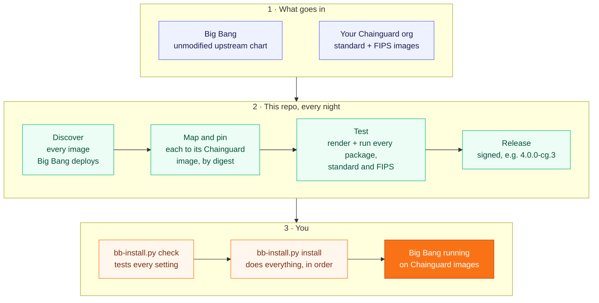

# Big Bang on Chainguard images

Run [Big Bang](https://repo1.dso.mil/big-bang/bigbang) with images from **your own
Chainguard org** (`cgr.dev/<org>`) instead of Iron Bank, with FIPS as an option.

Big Bang itself is not forked. This repo turns the unmodified upstream chart into a
deployment on Chainguard images, tests it, and releases it; you install it with one tool.

**[Read the briefing (PDF, 19 slides)](docs/big-bang-on-chainguard-briefing.pdf)**: why run
Big Bang on Chainguard images, what this repo's scans and tests show, and how to start.



When Chainguard patches an image, the nightly run tests it and releases it on its own; a
new Big Bang version gets its own pull request, with the same tests and upgrade notes
([docs/upgrades/](docs/upgrades/)), and a person merges it. Moving
a cluster to a new release is `bb-install.py upgrade`.

## Install

Three commands:

```bash
chainctl auth login                          # once: the installer makes your pull token with it
python scripts/bb-install.py check           # tests every setting; changes nothing
python scripts/bb-install.py install         # add --fips for FIPS images
```

The first run asks for your domain and the packages you want, and saves them in
`my-site.yaml`. `install` then does everything in order: pull secrets, Flux, object
storage, Big Bang, TLS and image-signature checks. It waits until every package is healthy
and prints each app's URL. It is safe to run again.

**`check` tests every setting before anything changes:**

- your tools and cluster: kubectl, helm, Kubernetes 1.35 or newer, a default StorageClass;
- your site file: Big Bang renders with it, so a misspelled or outdated key is caught;
- your logins: every Chainguard image your packages use, and every image this repo builds,
  is test-pulled, which also proves your Chainguard plan covers them;
- the upgrade path from what the cluster runs now.

`install` and `upgrade` run the same checks first and stop before touching the cluster if
one fails.

**After that:**

```bash
python scripts/bb-install.py status          # what's healthy, and the app URLs
python scripts/bb-install.py upgrade         # move to a newer release, including from Big Bang 3
python scripts/bb-install.py rollback        # back to the previous revision
```

`upgrade` shows what will change and asks before applying it. From Big Bang 3 it also
converts your site file to Big Bang 4's keys and keeps the original.

**You need** a Kubernetes 1.35+ cluster with a default StorageClass, and `kubectl`, `helm` 3,
Python 3 with PyYAML and `chainctl`. To skip installing the tools, run the same commands
from the installer image: `scripts/bb-docker.sh check`, then `scripts/bb-docker.sh install`.
On each node, raise the inotify limits (`fs.inotify.max_user_instances=8192`,
`fs.inotify.max_user_watches=524288`): NeuVector's enforcer exits at the common default of 128
([RKE2 test](docs/testing.md)). `bb-install.py check` reads them on each node.

More: [every installer option](docs/install.md) (TLS, signatures, GitOps, air-gapped sites,
doing it by hand) · [Quickstart](docs/quickstart.md) (pinning and verifying a release) ·
[your own Chainguard org](docs/your-org.md).

## Why Chainguard images instead of Iron Bank's

**Run the same, unmodified Big Bang on images with almost no known vulnerabilities.**
Chainguard rebuilds every image from source, keeps it minimal, and patches it continuously.
This repo swaps those images in for Iron Bank's across every package, with a FIPS twin for
almost every one and signatures you can check. Every change is deployed and tested on
Kubernetes (kind in CI) before it reaches you. You get a smaller attack surface, far less CVE
triage, and FIPS with one switch, without forking Big Bang.

Security first. Every number below comes from the repo's own scans and tests; the CVE
counts are from grype on **2026-11-02**, and the [weekly CVE report](.github/workflows/cve-report.yml)
refreshes them.

- **A fraction of Iron Bank's known vulnerabilities.** Iron Bank's images need an
  account to scan, but their recipes are public, and each one names the base image it is
  built FROM (Red Hat UBI 9 for most). We scanned the public copy of each base. For the 67
  images whose base resolves:
  - **Iron Bank's bases alone**, before any application is added, carry **840 High and
    6,688 Medium** CVEs.
  - **The complete Chainguard replacements**, application included, carry **31 High and
    29 Medium**.
  - In **53 of the 67**, the whole Chainguard image has fewer Critical and High CVEs than
    the Iron Bank image's base alone.
  - Counts are summed per image; same scanner (grype) and same day for both sides. The
    Iron Bank figures are a floor: the real images also carry their applications.
- **Almost no known vulnerabilities.** Big Bang's Iron Bank images are replaced by 111
  Chainguard images. Of those:
  - **105 (95%) have no Critical CVE**;
  - **83 have no Critical or High** (88 of the 111 FIPS images);
  - **68 have no known CVE at all**.

  Across all 111 there are **6 distinct Critical CVEs**. All are in third-party code:
  GitLab EE's Rails images (GraphicsMagick and Python), Gitaly (containerd) and Grafana's
  image renderer (Chromium). Upstream has published a fix for only one of them so far.
- **A fixable Critical can't sneak in.** Every pull request scans the images it adds, and
  CI fails if one has a Critical CVE that already has a fix (`bb-cve.py --changed-from`).
  That includes the nightly update.
- **Patched continuously.** Every night the overlays move to
  the newest patch in your org, pinned by digest. CI rejects any image Chainguard hasn't
  rebuilt in 30 days, so an abandoned release line can't stay deployed.
  - Where your org doesn't have Iron Bank's minor version, the replacement is a newer
    minor (31 image references), never an older one. Each case is listed in `docs/images.md`.
- **A supply chain you can verify.**
  - Every Chainguard image's signature is checked on every pull request.
  - The images this repo builds are signed keylessly, with an SBOM and SLSA provenance
    attached.
  - Every image is pinned by digest, so a cluster runs exactly what CI tested.
  - The installer adds a Kyverno policy that refuses unsigned images (enforce mode by
    default).
  - Each release archive is signed by the release workflow.
- **FIPS with one switch.** 177 of the 183 converted image references have a `-fips`
  twin; the other 6 are listed with the reason. `--fips` (or the FIPS overlay) turns
  them on.
  - Each kind test runs in both standard and FIPS mode ([docs/testing.md](docs/testing.md)
    lists the exceptions).
  - Kyverno, Grafana and Keycloak also pass on a RHEL 9 node whose kernel is in FIPS mode.
- **Minimal images.** Chainguard builds each image with only the application and what it
  needs to run. By Chainguard's design, the runtime images ship without a package manager,
  so there is less to patch and less to exploit.
  - For the 67 images compared above, the median Chainguard image, application
    included, is **83 MB** standard and 116 MB FIPS.
  - The median Iron Bank base image alone, before the application, is **107 MB**.
- **Tested on Kubernetes, not just rendered.**
  - **38 runtime tests**, each with a functional check of the app: a Loki query, a
    Velero backup, a GitLab readiness check, and so on.
  - A **release-to-release upgrade test** on every change.
  - **About 600 unit tests**.
- **Problems found and fixed before you hit them.** The runtime tests found **40 problems**
  that rendering alone would miss, each fixed in the overlays and listed in
  [docs/testing.md](docs/testing.md#what-the-runtime-tests-found). Examples:
  - an Istio sidecar still pulled from Iron Bank;
  - Gatekeeper refusing every non-Iron Bank image;
  - GitLab's migrations running out of PostgreSQL locks;
  - Thanos with no stores.
- **No fork, no lock-in.** Big Bang is unchanged. The repo writes values overlays, and
  [one command](docs/quickstart.md) installs, upgrades or rolls back.

> **Status: beta.** Use it for development, test and evaluation clusters; it isn't
> supported for production yet. Install from a pinned release, not `main`.
> **[Quickstart](docs/quickstart.md)** has the steps and what is and isn't proven yet.

## Use it with your org

The overlays in this repository point at Zapata Technology's Chainguard org. For your own
org, generate them once in your copy of the repository, then install as above:

```bash
python scripts/bb-run.py --org <your org> --build-registry ghcr.io/<owner> --save
```

[Running it on your own Chainguard org](docs/your-org.md) covers what your Chainguard plan
needs, building this repo's images into your registry, and CI for your copy.

## Object storage: SeaweedFS (default) or MinIO

Packages that need S3 storage (Tempo, Thanos, Mimir, Mattermost, GitLab, Velero) get it
without any setup: the installer runs SeaweedFS in the cluster, from your org's image, with
generated keys and a bucket for each package.

- **Your own S3 service instead:** set `OBJECT_STORAGE_ENDPOINT` to it before installing.
- **Big Bang's MinIO instead:** set `OBJECT_STORAGE=minio`.

[How it works](docs/how-it-works.md#object-storage) has what each package stores and the
settings behind it.

## Known gaps

What this repo doesn't do yet, and what each needs. `docs/images.md` has the per-image detail.

| Gap | Why | What closes it |
|---|---|---|
| Some images stay on Iron Bank (none in the default packages; [the current list](docs/images.md)) | Vendor products (Twistlock, Fortify, Anchore Enterprise, ...), Red Hat UBI bases, and GitLab images Chainguard doesn't build | Chainguard publishing them: the nightly run reports each one (`until:`) when the org has tags |
| Release-to-release upgrades are tested for a few packages only | `compat/release-upgrade.yaml` upgrades Kyverno, Headlamp and Grafana from the newest release on every pull request; other packages' upgrades rely on Flux and Helm rolling new digests, which that test checks | More packages in that test as kind's runner allows; a staging cluster that follows releases |
| Keycloak's images stay on tags, not digests | Big Bang 4.0.0's Keycloak template can't take a post-renderer (`no_post_renderers`) | A Big Bang release that fixes the template; `bb-scan.py` reports when it does |
| Images in custom resources stay on tags | Kiali's CR and Istio's injected proxy are set outside pod specs, where kustomize can't pin | Nothing planned: their tags are exact |
| Some images are a newer version than Iron Bank's | The org keeps only current release lines (`MINOR AHEAD`, `min_version`) | Each is listed in `docs/images.md`; packages with a compat test run them |
| Iron Bank's side of the weekly CVE report is empty, and the Vault 1.21 to 2.x upgrade test (`compat/vault-upgrade.yaml`) is skipped | Both need an Iron Bank account | The `REGISTRY1_USERNAME` and `REGISTRY1_PASSWORD` secrets |
| Some images have open Critical CVEs | See [SECURITY.md](SECURITY.md#known-vulnerabilities) | Chainguard rebuilds, or a rebuild of the images built here |

## Learn more

- [Briefing (PDF)](docs/big-bang-on-chainguard-briefing.pdf): the case for Big Bang on
  Chainguard in 19 slides, with this repo's CVE counts and tests (November 2026).
- [Quickstart](docs/quickstart.md): install from a pinned, signed release.
- [Installer details](docs/install.md): every option, registry logins, TLS, signatures,
  air-gapped sites, upgrading from Big Bang 3.
- [Your own Chainguard org](docs/your-org.md): what your plan needs, and CI for your copy.
- [How it works](docs/how-it-works.md): the conversion, version rules, the images this repo
  builds, releases.
- [Image versions: Iron Bank vs Chainguard](docs/version-differences.md): every image's
  version on each side, and which ones differ.
- [Testing](docs/testing.md): what's tested and what the tests found.

## Contributing and support

- Changes are welcome as pull requests: see [CONTRIBUTING.md](CONTRIBUTING.md).
- Security issues and the controls in place: see [SECURITY.md](SECURITY.md).
- For the Big Bang team: [`docs/for-big-bang.md`](docs/for-big-bang.md).

## License

[Apache License 2.0](LICENSE). Copyright 2026 Zapata Technology; see [NOTICE](NOTICE).
