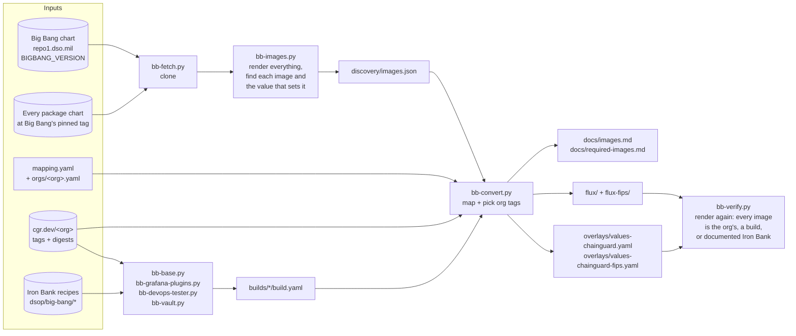
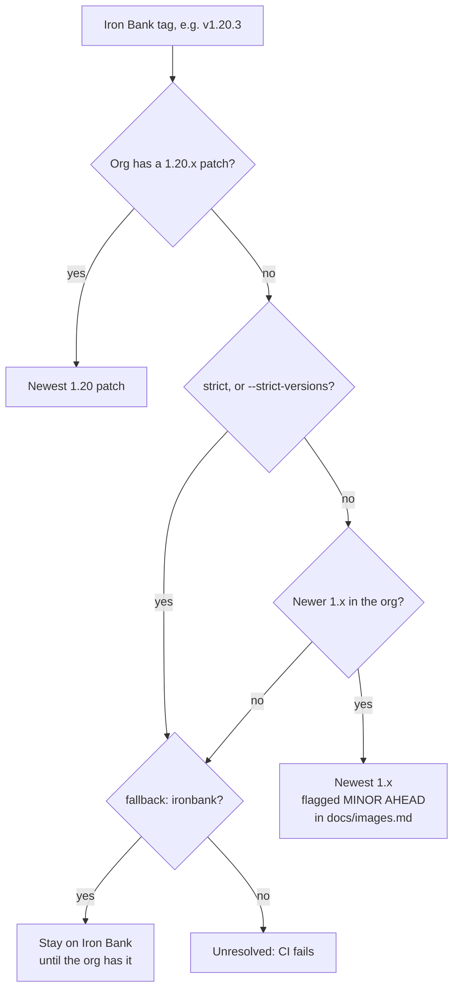
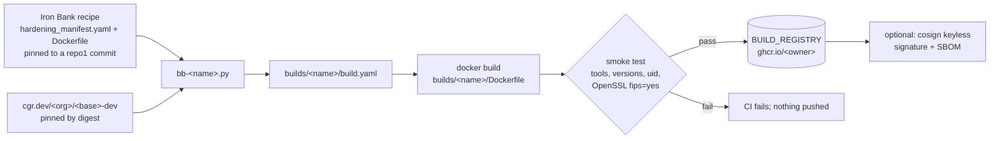
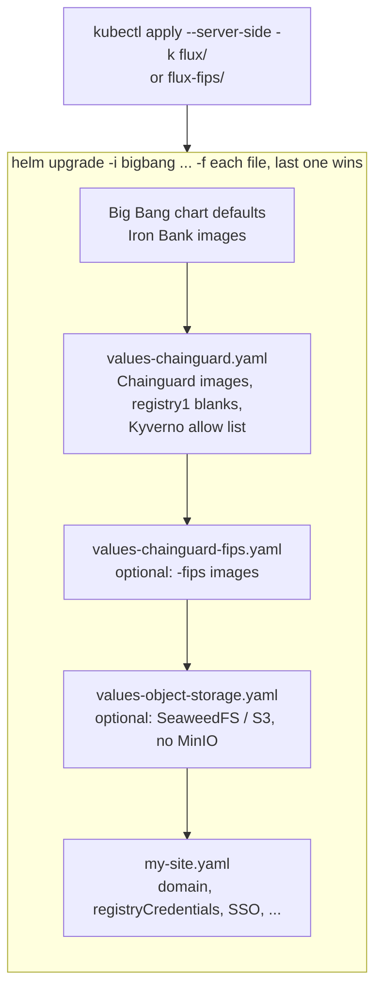
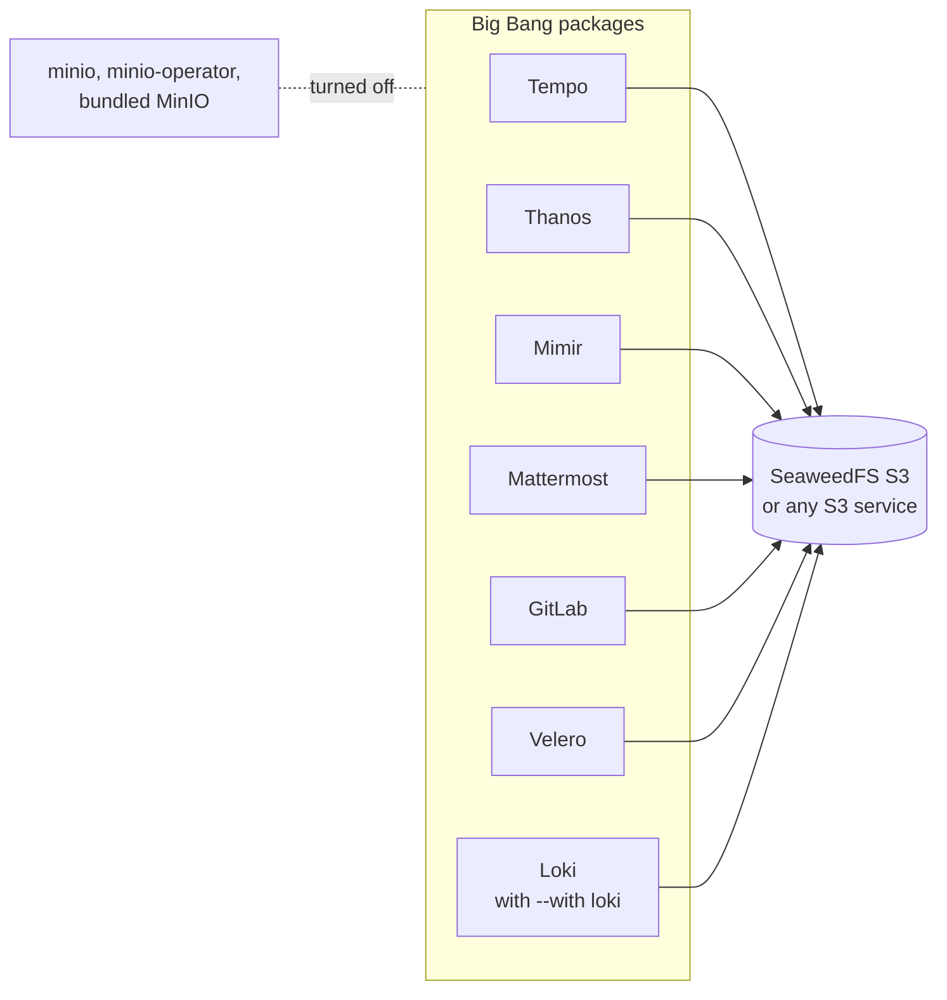
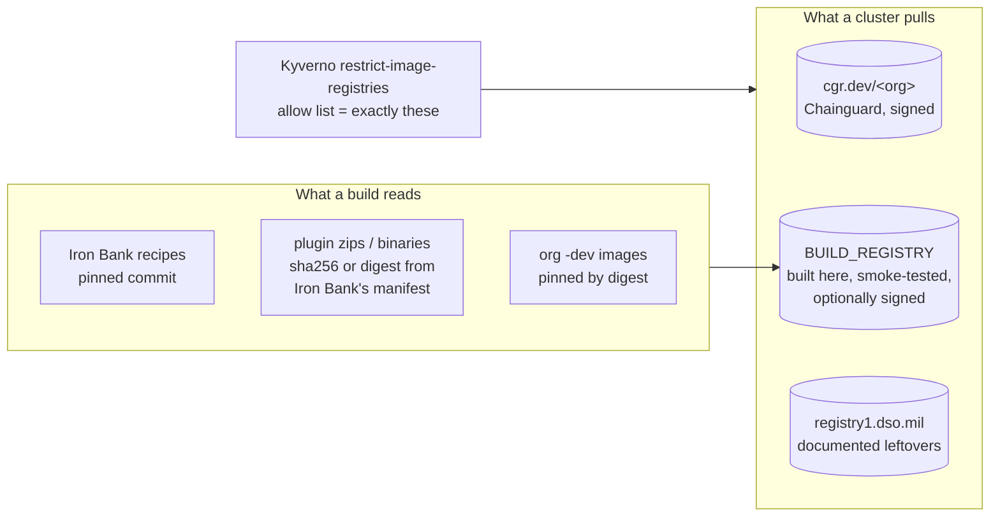

# How bigbang-chainguard works

This repo turns upstream Big Bang into a deployment on Chainguard images from **your**
Chainguard org. It never forks Big Bang: everything it produces is a values overlay (or a
Flux kustomization) layered on the unmodified chart. These diagrams show the pieces and how
they fit together.

## 1. The conversion pipeline



- **Discovery** renders Big Bang with every package turned on, then each package with the
  values Big Bang gives it. It records each Iron Bank image and the exact value path that
  sets it: a repository/tag pair, a single string, a registry split, or an image inside a list.
- **Conversion** maps each image (`mapping.yaml`, with your org's exceptions in
  `orgs/<org>.yaml`). It then picks a tag from **your** org: the newest patch on the line
  Iron Bank pins. It writes overrides at those same value paths, so the chart's own templates
  produce the Chainguard reference.
- **Verification** renders everything again with the overlays, and fails on any image that
  isn't converted, built here, or documented as staying on Iron Bank.

## 2. Picking a tag



Two more options change this per image:

- `group:` makes images move together. GitLab's images all convert, or all stay, so they
  stay on one GitLab release.
- `version_from:` matches another image's Iron Bank tag. GitLab's registry, shell and
  exporter use this, because Chainguard tags them with the GitLab release.

## 3. Images this repo builds

Chainguard doesn't publish Big Bang's own images. For those, a script converts **Iron Bank's
own recipe** into a build FROM your org's images. Vault also gets a build, to add the curl
that Big Bang's post-start hook needs.



| Image | Iron Bank source | Built FROM |
|---|---|---|
| `bigbang-base` | `big-bang/base` | `kubectl(-fips)-dev` |
| `bigbang-grafana-plugins` | `big-bang/grafana/grafana-plugins` | `grafana(-fips)` |
| `bigbang-devops-tester` | `big-bang/devops-tester` | `kubectl(-fips)-dev` |
| `bigbang-vault` | `hashicorp/vault` (adds curl) | `vault(-fips)-dev` |

## 4. Deploying: how the overlays layer



- **Flux comes first.** When your org's Flux controllers are newer than Big Bang's, `flux/`
  installs the upstream Flux release they belong to, with Big Bang's patches. Big Bang's own
  CRDs would be too old for them.
- **The FIPS switch is one extra file.** Leave out `values-chainguard-fips.yaml` for
  standard images, and add it for FIPS. Switching an existing install is an in-place
  `helm upgrade`.
- **Credentials live only in your site file:** `cgr.dev`, your build registry, and registry1
  for the images that stay on Iron Bank.

## 5. Keeping it current

```mermaid
sequenceDiagram
    autonumber
    participant N as update.yml (nightly 03:00 UTC)
    participant PR as Pull request
    participant CI as ci.yml + builds.yml
    participant M as main
    participant B as builds.yml (push)
    participant G as BUILD_REGISTRY

    N->>N: newest Big Bang tag? fetch, discover
    N->>N: re-read Iron Bank recipes, re-pin org digests
    N->>N: bb-convert + bb-verify (standard, FIPS)
    N->>PR: open bot/bigbang-update
    PR->>CI: unit tests, discovery, verify; build + smoke-test images
    CI-->>PR: checks
    PR->>M: merge (you)
    M->>B: push to main
    B->>G: build, test, push (+ sign)
```

`compat.yml` is separate. It runs on pull requests that change `compat/`, or by hand, and
deploys single packages on kind to prove they **run**, not just render, and checks
every running image against the image policy. See [testing.md](testing.md).

## 6. Object storage (optional)



`scripts/bb-object-storage.py` writes this overlay from `object-storage.yaml`. Credentials
stay in the site file, and `--verify` fails if any MinIO server is still deployed.

## 7. Trust boundaries



- A cluster only pulls from the three registries Kyverno allows. The overlay sets that list.
- Every input to a build is pinned: Iron Bank's recipe by commit, each download by sha256 or
  digest, and each base image by digest.
- CI identities are scoped. The Chainguard pull identity is trusted only for this repo's
  `main` branch and pull requests. GitHub Actions are pinned to commit SHAs, and runners are
  hardened. See [SECURITY.md](../SECURITY.md).
