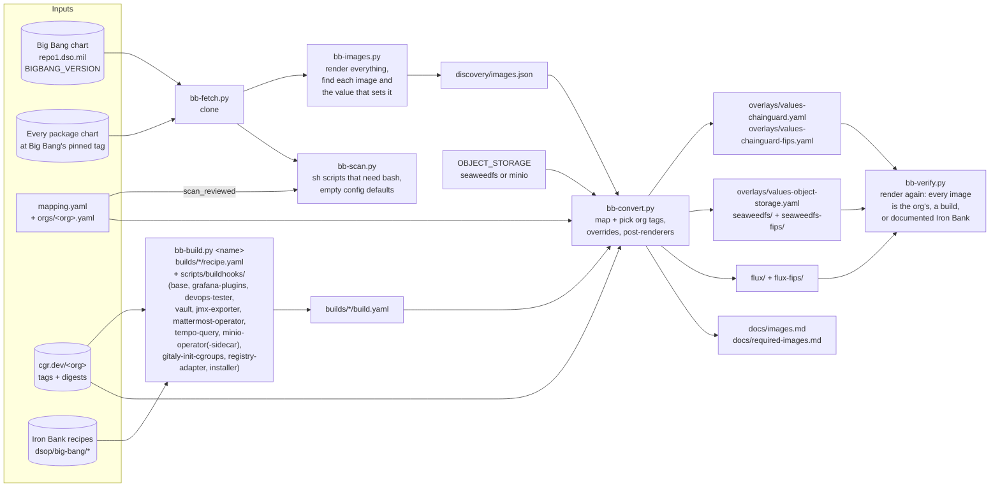
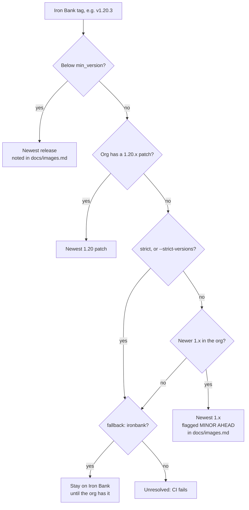
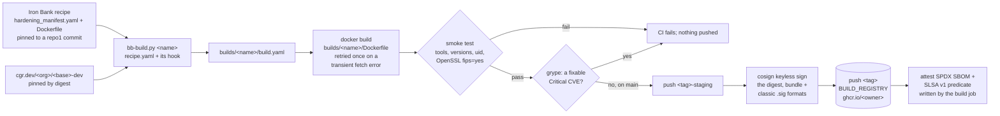
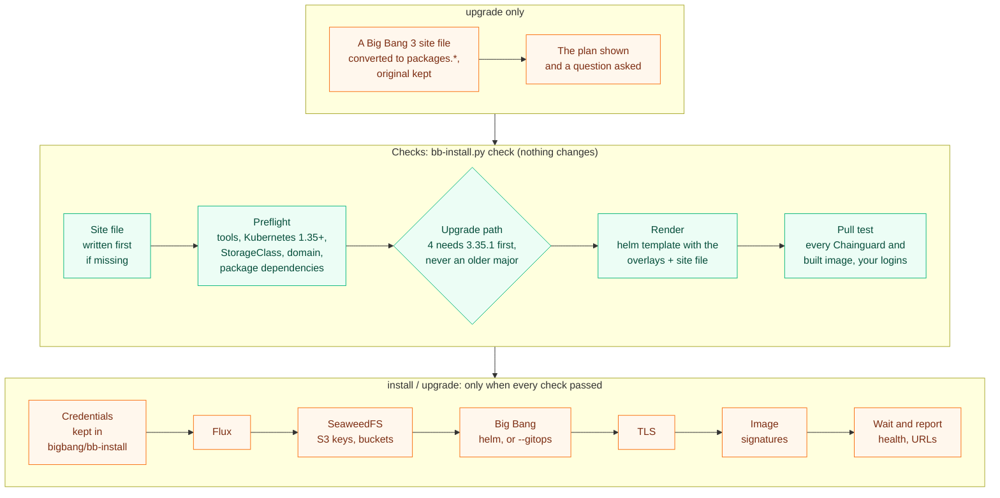
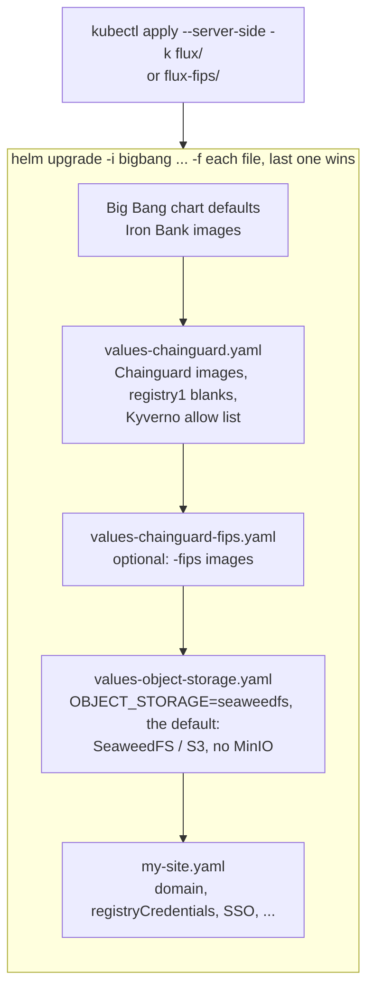
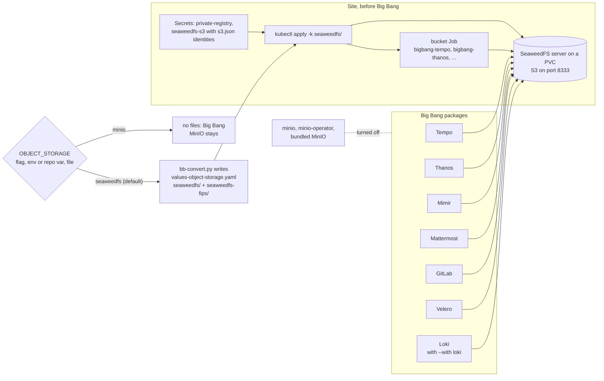
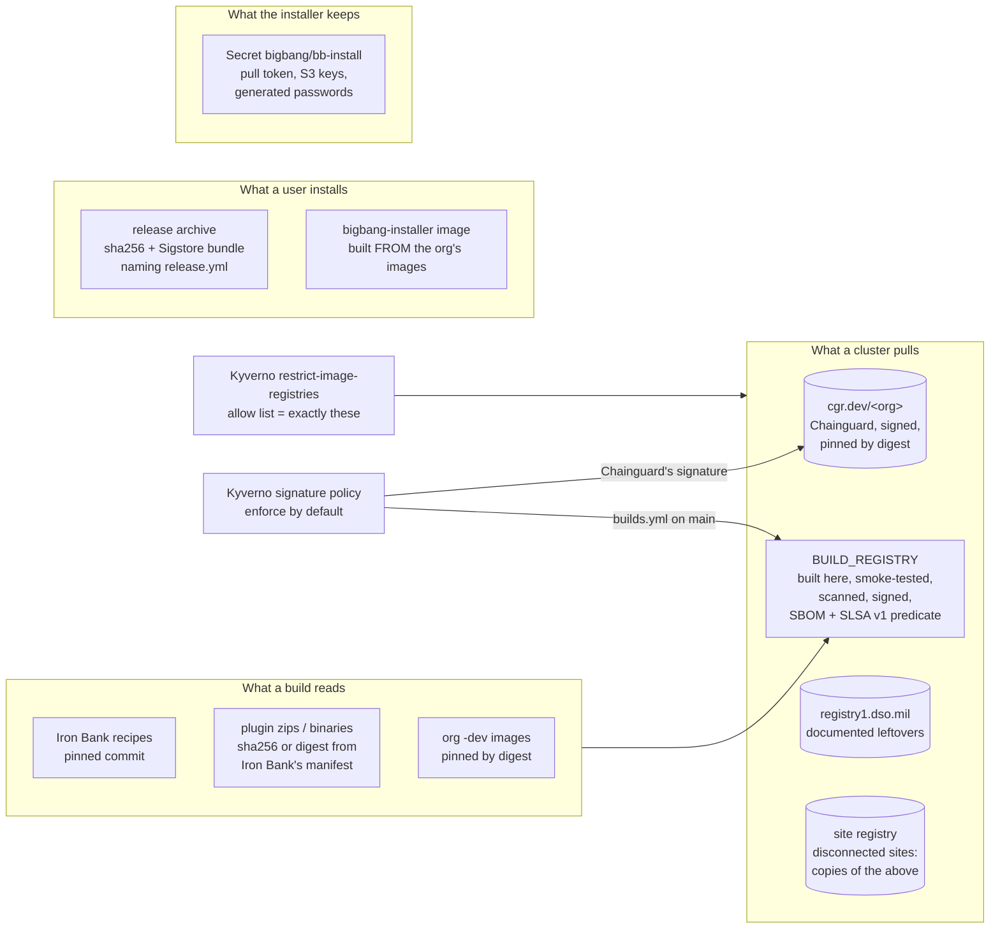
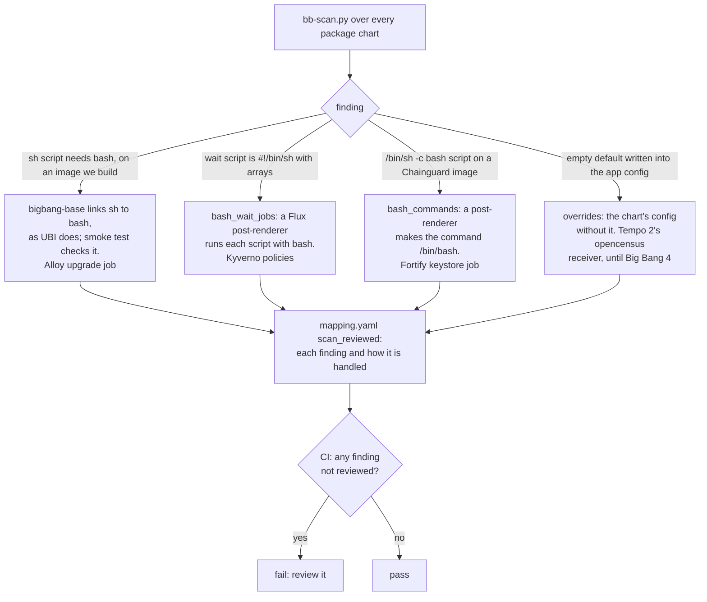

# How bigbang-chainguard works

This repo turns upstream Big Bang into a deployment on Chainguard images from **your**
Chainguard org. It never forks Big Bang: everything it produces is a values overlay (or a
Flux kustomization) layered on the unmodified chart. These diagrams show the pieces and how
they fit together.

## 1. The conversion pipeline



- **Discovery** renders Big Bang with every package turned on, then each package with the
  values Big Bang gives it. It records each Iron Bank image and the exact value path that
  sets it: a repository/tag pair, a single string, a registry split, or an image inside a list.
- **Conversion** maps each image (`mapping.yaml`, with your org's exceptions in
  `orgs/<org>.yaml`). It then picks a tag from **your** org: the newest patch on the line
  Iron Bank pins. It writes overrides at those same value paths, so the chart's own templates
  produce the Chainguard reference.
- **Verification** renders everything again with the overlays, and fails on any image that
  isn't converted, built here, or documented as staying on Iron Bank. With SeaweedFS it
  also fails if any MinIO is still deployed.
- **The scan** reads every package chart for things a new image name can't fix: shell
  code run by `sh` that needs bash, and empty defaults written into an app's config.
  Each finding must be reviewed in `mapping.yaml` (section 8).

## 2. Picking a tag



Two more options change this per image:

- `group:` makes images move together. GitLab's images all convert, or all stay, so they
  stay on one GitLab release.
- `version_from:` matches another image's Iron Bank tag. GitLab's registry, shell and
  exporter use this, because Chainguard tags them with the GitLab release.
- `min_version:` raises an end-of-life line to the newest release. kubectl uses `1.34`, so a
  chart that pins an end-of-life kubectl (Vault's 1.30, in Big Bang 3) doesn't pull an
  image Chainguard stopped rebuilding.

## 3. Images this repo builds

Chainguard doesn't publish Big Bang's own images (base, grafana-plugins, devops-tester).
For those, a script converts **Iron Bank's own recipe** into a build FROM your org's images.
Eight more get a build for what Chainguard's image lacks or doesn't publish: Vault (the
curl Big Bang's post-start hook needs), the JMX exporter (SonarQube's init container copies
its jar with sh and curl), and, built from upstream's source, the Mattermost Operator,
tempo-query, the MinIO Operator and its sidecar, GitLab's gitaly-init-cgroups and NeuVector's
registry adapter. The table
lists them all.



With `SIGN_IMAGES=keyless`, each image is signed **before its release tag moves to it**:
`builds.yml` pushes `<tag>-staging`, signs that digest, then pushes `<tag>`. A cluster
enforcing signatures never sees the tag on an unsigned image. Pushes are retried (GHCR
refuses a new package's first push now and then). The provenance record
(`scripts/bb-provenance.py`) is a SLSA v1 predicate the build job writes. It is not a
SLSA Build L3 attestation. It names the workflow run, the commit and every pinned input
from `build.yaml`.

| Image | Iron Bank source | Built FROM |
|---|---|---|
| `bigbang-base` | `big-bang/base` | `kubectl(-fips)-dev` |
| `bigbang-grafana-plugins` | `big-bang/grafana/grafana-plugins` | `grafana(-fips)` |
| `bigbang-devops-tester` | `big-bang/devops-tester` | `kubectl(-fips)-dev` |
| `bigbang-vault` | `hashicorp/vault` (adds curl) | `vault(-fips)-dev` |
| `bigbang-jmx-exporter` | `opensource/prometheus/jmx-exporter` (the javaagent jar, plus curl) | `busybox(-fips)-dev` |
| `bigbang-mattermost-operator` | `opensource/mattermost/mattermost-operator` (built from upstream's source) | `go(-fips)-dev` or `kubectl(-fips)-dev`, onto `glibc-openssl(-fips)` or `kubectl(-fips)` |
| `bigbang-tempo-query` | `opensource/grafana/tempo-query` (built from upstream's source) | as the Mattermost Operator |
| `bigbang-minio-operator`, `bigbang-minio-operator-sidecar` | `opensource/minio/operator`, `operator-sidecar` (archived; built from upstream's archived source) | as the Mattermost Operator |
| `bigbang-gitaly-init-cgroups` | none: GitLab's CNG `gitaly-init-cgroups` (built from Gitaly's source as CNG builds it) | as the Mattermost Operator |
| `bigbang-registry-adapter` | `opensource/neuvector/registry-adapter` (built from upstream's source, cgo) | as the Mattermost Operator |
| `bigbang-installer` | none (the installer itself: bb-install.py, kubectl, helm, Python, the chart) | `kubectl(-fips)-dev` |

The Go builds (the Mattermost Operator, tempo-query, the MinIO Operator) use the `go`/`glibc-openssl` images when the org has them. Without
them it builds in `kubectl(-fips)-dev` with Wolfi's Go and runs on `kubectl(-fips)`, and the
FIPS image uses Go's own FIPS 140-3 module (`GOFIPS140`) instead of `go-fips`. The next
build switches over once the org has those images. Chainguard's `go-fips` itself changed with
Go 1.27: through 1.26 it uses an OpenSSL backend (`GOEXPERIMENT=systemcrypto`), from 1.27 Go's
validated FIPS module with cgo (`GOFIPS140=v1.0.0-…`, `fips140=on`); the build's smoke test
accepts either (`bbbuild.GO_FIPS_BUILDS`).

## 4. Deploying: how the overlays layer

Three commands share one set of checks. `check` stops after them and changes nothing;
`install` and `upgrade` go on only if every one passes. (`scripts/bb-docker.sh` runs the
same commands from the installer image.)



- **The render** catches a misspelled key, a value of the wrong type, or a Big Bang 3 key
  (`tempo:`, `addons.keycloak:`), with the chart's own error, before any HelmRelease fails.
- **GitLab's database.** When GitLab is enabled, preflight adds a note: PostgreSQL
  `max_locks_per_transaction` must be 256. The chart does not set that on the external
  server. The note does not stop the install.
- **The pull test** asks each registry for every image's manifest with the login it was
  given. A refused pull from the org is usually an image the Chainguard plan doesn't cover.
  `check` uses a short-lived token from your chainctl login and stores nothing; `install`
  asks again for a refused login, up to three tries. `--no-pull-check` skips it for a
  registry only the nodes can reach.
- **`upgrade`** also shows what will change (version, FIPS, packages, image tags) and asks
  before it installs.

The layering it uses:



- **Flux comes first.** When your org's Flux controllers are newer than Big Bang's, `flux/`
  installs the upstream Flux release they belong to, with Big Bang's patches. Big Bang's own
  CRDs would be too old for them.
- **The FIPS switch is one extra file.** Leave out `values-chainguard-fips.yaml` for
  standard images, and add it for FIPS. Switching an existing install is
  `bb-install.py install --fips` (and back without it).
- **Credentials live only in your site file:** `cgr.dev`, your build registry, and registry1
  for the images that stay on Iron Bank.

## 5. Keeping it current

```mermaid
sequenceDiagram
    autonumber
    participant N as update.yml (nightly, 03:17 UTC)
    participant PR as Pull request
    participant CI as ci.yml + builds.yml + compat.yml
    participant M as main
    participant B as builds.yml + release.yml (push)
    participant G as BUILD_REGISTRY + GitHub release

    N->>N: newest Big Bang tag? fetch, discover
    N->>N: re-read Iron Bank recipes, re-pin org digests
    N->>N: bb-convert (tags and today's digests) + bb-verify (standard, FIPS)
    N->>N: bb-scan: new sh-needs-bash or empty defaults<br/>bb-leftovers: Iron Bank leftovers now published
    N->>PR: open bot/bigbang-update (deployed release, newest patches)<br/>and, for a newer Big Bang, bot/bigbang-release<br/>with upgrade notes (docs/upgrades/)
    PR->>CI: unit tests, discovery, scan, verify, signatures,<br/>no fixable Critical CVE in new images,<br/>build + smoke-test changed images,<br/>kind tests the change reaches, or the smoke set<br/>for a digest-only change
    CI-->>PR: checks, including results-gate<br/>(a recorded standard matrix for this Big Bang version)
    PR->>M: automerge.yml when every check passed<br/>(bot/bigbang-release: you, or itself for a patch<br/>release with AUTOMERGE_BIGBANG_PATCHES)
    M->>B: push to main
    B->>G: build, scan, sign, then move the tag,<br/>SBOM + SLSA v1 predicate, tag &lt;bigbang&gt;-cg.&lt;n&gt;,<br/>signed archive and notes
```

Every org image is pinned to the digest its tag had when the overlays were generated
(a Flux post-renderer swaps each pod image to `repo@sha256:...`; values keep the tag,
which charts reuse in labels). Chainguard rebuilds images under the same tag, so without
the pin a rebuild would reach clusters on the next pod restart, untested. With it, a
rebuild arrives only as a new digest in the nightly pull request. `compat.yml` then
runs the smoke kind tests (Kyverno, metrics-server, Tempo, Keycloak, Kiali, Velero),
not every package. The weekly run deploys every package, including GitLab.
`results-gate` fails the pull request while this Big Bang version has no recorded
standard-mode matrix. A skipped run is not a pass. Tests marked `registry1: true`
stay outside that gate.

`compat.yml` runs on pull requests that change what clusters run (`overlays/`, `flux*/`,
`mapping.yaml`, `orgs/`, `compat/`, the installer) and weekly with the large tests
(GitLab), and deploys packages on kind to prove they **run**, not just render, checking
every running image against the image policy. While each test waits, a watcher reads
every container's log: it prints errors as they happen, stops the test early on a
failure that won't recover, and fails it on an OOM kill. Every job uploads its logs
and the cluster's state as an artifact. See [testing.md](testing.md).

`automerge.yml` reads the pull request and its check runs with the workflow's own
token and merges with `RELEASE_PAT`, so the merge starts `builds.yml` and `release.yml`
on main (a merge made with the workflow token wouldn't). Each such merge that changes
what users deploy becomes a release `<bigbang>-cg.<n>`.
`cve-report.yml` compares Iron Bank's and Chainguard's images with grype every week.

`bb-leftovers.py` checks each `{stays: ..., until: <name>}` image against Chainguard's
catalog and your org. When Chainguard publishes one, the nightly report says so; add the
repository to your org, and the next run converts it.

## 6. Object storage (SeaweedFS by default)



With `OBJECT_STORAGE=seaweedfs` (the default), `bb-convert.py` writes the overlay from
`object-storage.yaml`, plus `seaweedfs/` (SeaweedFS from your org's image, S3 auth from a
Secret, a bucket Job). `OBJECT_STORAGE=minio` keeps Big Bang's own MinIO and deletes those
files. Credentials stay in the site file, and `bb-verify.py` fails if any MinIO is still
deployed.

Set credentials only for the packages you enable. Big Bang creates Mimir's credential
Secret whenever its keys are set, even with Mimir off, and the install then fails on the
missing `mimir` namespace.

## 7. Trust boundaries



- A cluster only pulls from the three registries Kyverno allows. The overlay sets that list.
- With Kyverno on, the installer's signature policy is in enforce mode by default
  (`--verify-signatures audit` or `off` to change it). Every `cgr.dev/<org>` image needs
  Chainguard's signature, and every `<build registry>/bigbang-*` image needs the keyless
  signature `builds.yml` makes on this repo's `main` (`--build-signer` names another repo).
  CI's `bb-signatures.py` checks the same two rules on every pull request.
- Org images are pinned by digest (section 5), so what runs is what CI tested.
- Releases are signed keylessly by `release.yml`; the release notes show the `cosign
  verify-blob` command.
- The installer keeps credentials in one Secret, `bigbang/bb-install`. Anyone who can read
  Secrets in the `bigbang` namespace can read them (SECURITY.md, "Credentials in the cluster").
- Every input to a build is pinned: Iron Bank's recipe by commit, each download by sha256 or
  digest, and each base image by digest. The SLSA v1 provenance predicate the build job
  writes (not a SLSA Build L3 attestation) lists them.
- CI identities are scoped. The Chainguard pull identity is trusted only for this repo's
  `main` branch and pull requests. GitHub Actions are pinned to commit SHAs.
- The CI, build and nightly runners block every outbound call they don't list
  (harden-runner); the kind tests audit instead. CodeQL and Scorecard start once the repo
  is public. See [SECURITY.md](../SECURITY.md).

## 8. Where Iron Bank's and Chainguard's images behave differently

Iron Bank builds most images on Red Hat UBI, where `/bin/sh` is bash. A Chainguard `-dev`
image's `/bin/sh` is busybox. Big Bang's scripts sometimes say `sh` and use bash (arrays,
here-strings), and those die on their first bash line. Separately, Flux renders some chart
defaults differently from Helm 3. Neither shows up when rendering. `bb-scan.py` finds them
in the charts; the kind tests found the first ones.



A new Big Bang release that adds one of these fails CI on the nightly pull request, before
any cluster runs it. A finding that goes away is reported too (`gone`), so a workaround is
removed when it isn't needed: Big Bang 4's Tempo 3 chart dropped the `opencensus` receiver,
and the Tempo override went with it.
