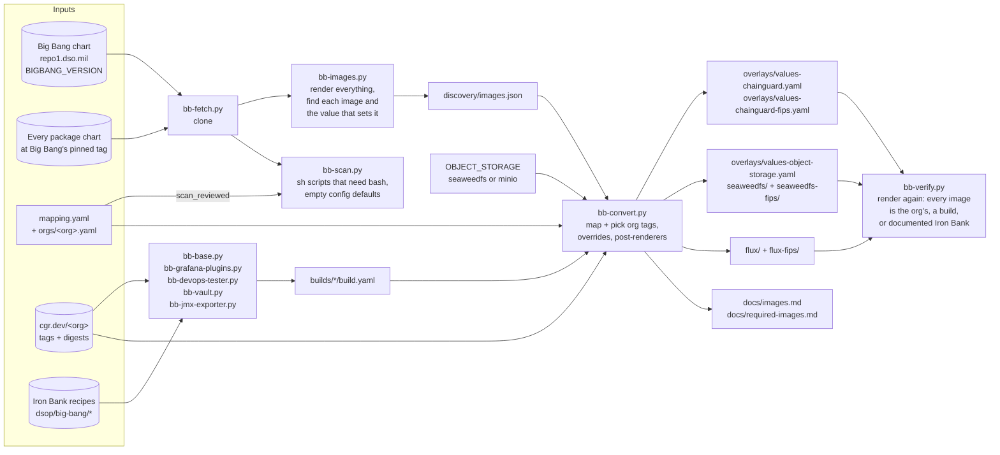
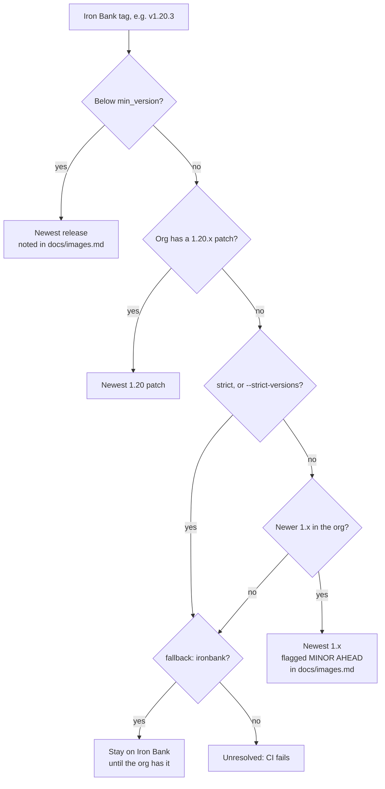
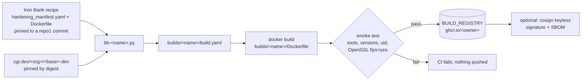
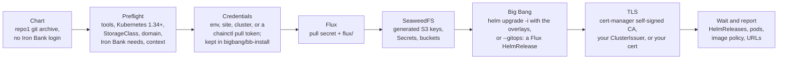
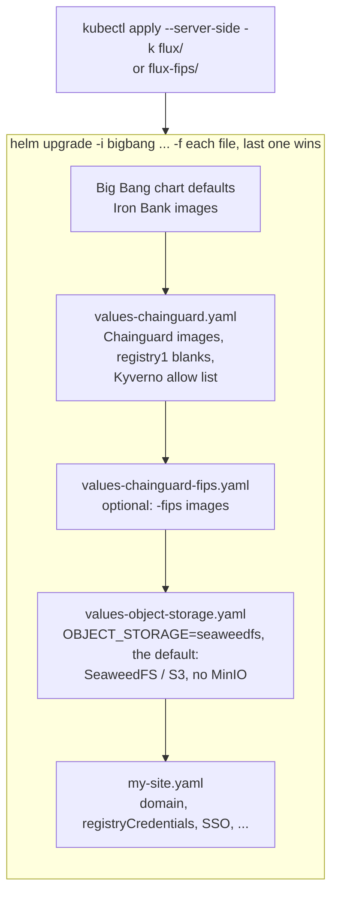
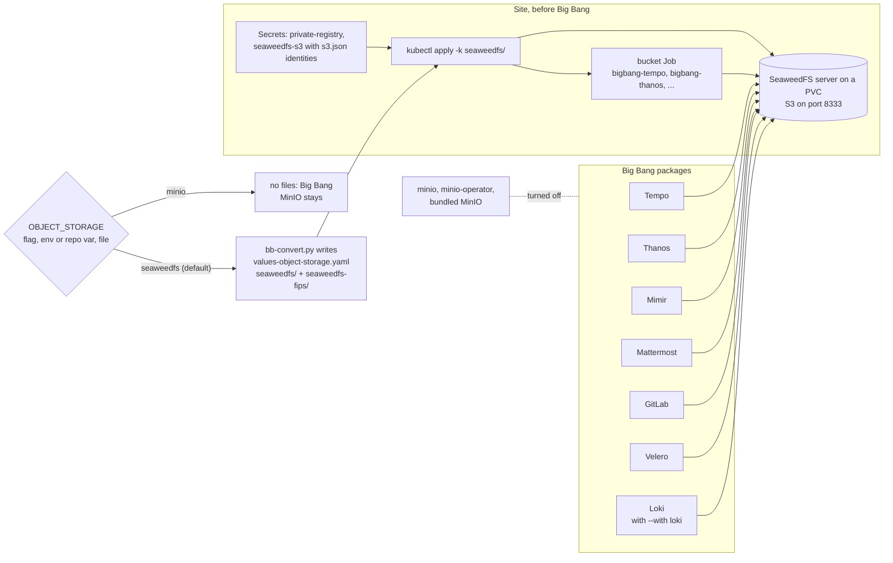
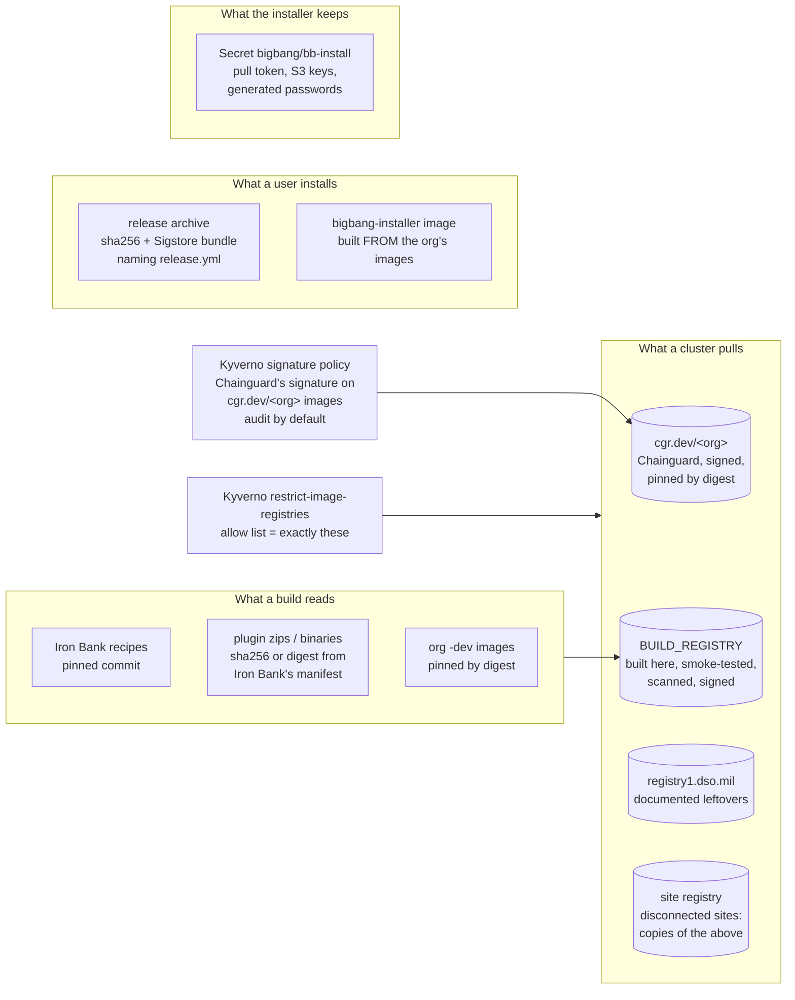
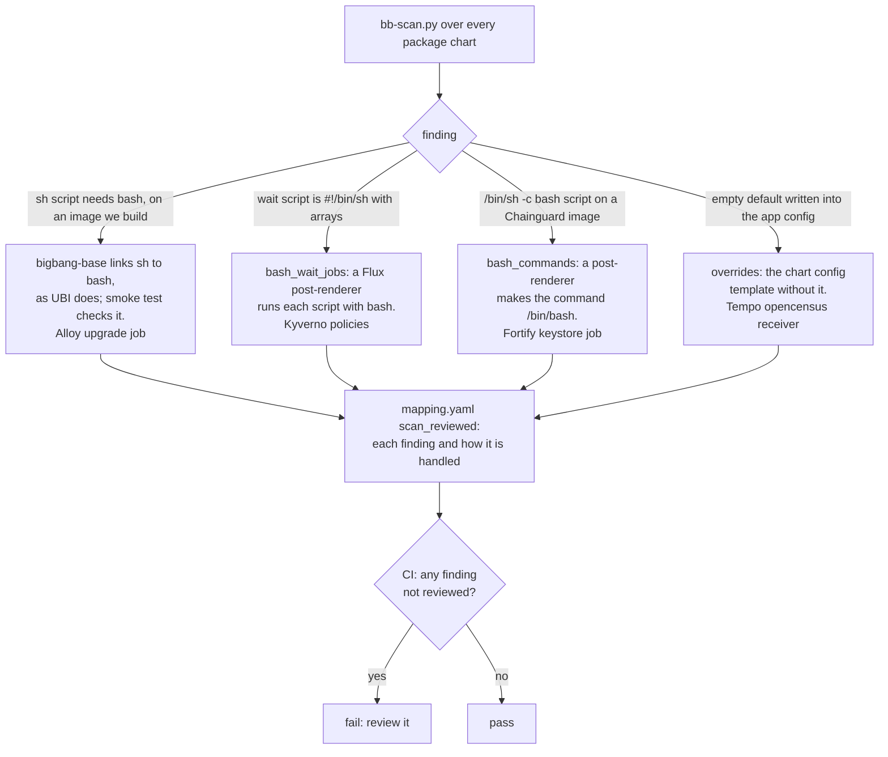

# How bigbang-chainguard works

This repo turns upstream Big Bang into a deployment on Chainguard images from **your**
Chainguard org. It never forks Big Bang: everything it produces is a values overlay (or a
Flux kustomization) layered on the unmodified chart. These diagrams show the pieces and how
they fit together.

## 1. The conversion pipeline



- **Discovery** renders Big Bang with every package turned on, then each package with the
  values Big Bang gives it. It records each Iron Bank image and the exact value path that
  sets it: a repository/tag pair, a single string, a registry split, or an image inside a list.
- **Conversion** maps each image (`mapping.yaml`, with your org's exceptions in
  `orgs/<org>.yaml`). It then picks a tag from **your** org: the newest patch on the line
  Iron Bank pins. It writes overrides at those same value paths, so the chart's own templates
  produce the Chainguard reference.
- **Verification** renders everything again with the overlays, and fails on any image that
  isn't converted, built here, or documented as staying on Iron Bank. With SeaweedFS it
  also fails if any MinIO is still deployed.
- **The scan** reads every package chart for things a new image name can't fix: shell
  code run by `sh` that needs bash, and empty defaults written into an app's config.
  Each finding must be reviewed in `mapping.yaml` (section 8).

## 2. Picking a tag



Two more options change this per image:

- `group:` makes images move together. GitLab's images all convert, or all stay, so they
  stay on one GitLab release.
- `version_from:` matches another image's Iron Bank tag. GitLab's registry, shell and
  exporter use this, because Chainguard tags them with the GitLab release.
- `min_version:` raises an end-of-life line to the newest release. kubectl uses `1.34`, the
  oldest Kubernetes Big Bang supports, so Vault's kubectl 1.30 pin doesn't pull an
  unmaintained image.

## 3. Images this repo builds

Chainguard doesn't publish Big Bang's own images. For those, a script converts **Iron Bank's
own recipe** into a build FROM your org's images. Vault also gets a build, to add the curl
that Big Bang's post-start hook needs.



| Image | Iron Bank source | Built FROM |
|---|---|---|
| `bigbang-base` | `big-bang/base` | `kubectl(-fips)-dev` |
| `bigbang-grafana-plugins` | `big-bang/grafana/grafana-plugins` | `grafana(-fips)` |
| `bigbang-devops-tester` | `big-bang/devops-tester` | `kubectl(-fips)-dev` |
| `bigbang-vault` | `hashicorp/vault` (adds curl) | `vault(-fips)-dev` |
| `bigbang-jmx-exporter` | `opensource/prometheus/jmx-exporter` (the javaagent jar, plus curl) | `busybox(-fips)-dev` |
| `bigbang-installer` | none (the installer itself: bb-install.py, kubectl, helm, Python, the chart) | `kubectl(-fips)-dev` |

## 4. Deploying: how the overlays layer

`scripts/bb-install.py install --site my-site.yaml [--fips]` does all of this in order:



The layering it uses:



- **Flux comes first.** When your org's Flux controllers are newer than Big Bang's, `flux/`
  installs the upstream Flux release they belong to, with Big Bang's patches. Big Bang's own
  CRDs would be too old for them.
- **The FIPS switch is one extra file.** Leave out `values-chainguard-fips.yaml` for
  standard images, and add it for FIPS. Switching an existing install is an in-place
  `helm upgrade`.
- **Credentials live only in your site file:** `cgr.dev`, your build registry, and registry1
  for the images that stay on Iron Bank.

## 5. Keeping it current

```mermaid
sequenceDiagram
    autonumber
    participant N as update.yml (nightly 03:00 UTC)
    participant PR as Pull request
    participant CI as ci.yml + builds.yml + compat.yml
    participant M as main
    participant B as builds.yml + release.yml (push)
    participant G as BUILD_REGISTRY + GitHub release

    N->>N: newest Big Bang tag? fetch, discover
    N->>N: re-read Iron Bank recipes, re-pin org digests
    N->>N: bb-convert (tags and today's digests) + bb-verify (standard, FIPS)
    N->>N: bb-scan: new sh-needs-bash or empty defaults<br/>bb-leftovers: Iron Bank leftovers now published
    N->>PR: open bot/bigbang-update, report in the body
    PR->>CI: unit tests, discovery, scan, verify, signatures,<br/>no fixable Critical CVE in new images;<br/>build + smoke-test images; every package on kind
    CI-->>PR: checks
    PR->>M: merge (you)
    M->>B: push to main
    B->>G: build, scan, push (+ sign); tag &lt;bigbang&gt;-cg.&lt;n&gt;,<br/>signed archive and notes
```

Every org image is pinned to the digest its tag had when the overlays were generated
(a Flux post-renderer swaps each pod image to `repo@sha256:...`; values keep the tag,
which charts reuse in labels). Chainguard rebuilds images under the same tag, so without
the pin a rebuild would reach clusters on the next pod restart, untested. With it, a
rebuild arrives only as a new digest in the nightly pull request, which `compat.yml`
deploys on kind before it merges.

`compat.yml` runs on pull requests that change what clusters run (`overlays/`, `flux*/`,
`mapping.yaml`, `orgs/`, `compat/`, the installer) and weekly with the large tests
(GitLab), and deploys packages on kind to prove they **run**, not just render, checking
every running image against the image policy. See [testing.md](testing.md).
`cve-report.yml` compares Iron Bank's and Chainguard's images with grype every week.

`bb-leftovers.py` checks each `{stays: ..., until: <name>}` image against Chainguard's
catalog and your org. When Chainguard publishes one, the nightly report says so; add the
repository to your org, and the next run converts it.

## 6. Object storage (SeaweedFS by default)



With `OBJECT_STORAGE=seaweedfs` (the default), `bb-convert.py` writes the overlay from
`object-storage.yaml`, plus `seaweedfs/` (SeaweedFS from your org's image, S3 auth from a
Secret, a bucket Job). `OBJECT_STORAGE=minio` keeps Big Bang's own MinIO and deletes those
files. Credentials stay in the site file, and `bb-verify.py` fails if any MinIO is still
deployed.

Set credentials only for the packages you enable. Big Bang creates Mimir's credential
Secret whenever its keys are set, even with Mimir off, and the install then fails on the
missing `mimir` namespace.

## 7. Trust boundaries



- A cluster only pulls from the three registries Kyverno allows. The overlay sets that list.
  With `bb-install.py --verify-signatures` (audit by default when Kyverno is on), Kyverno
  also checks Chainguard's signature on every `cgr.dev/<org>` image a Pod runs.
- Org images are pinned by digest (section 5), so what runs is what CI tested.
- Releases are signed keylessly by `release.yml`; the release notes show the `cosign
  verify-blob` command.
- The installer keeps credentials in one Secret, `bigbang/bb-install`. Anyone who can read
  Secrets in the `bigbang` namespace can read them (SECURITY.md, "Credentials in the cluster").
- Every input to a build is pinned: Iron Bank's recipe by commit, each download by sha256 or
  digest, and each base image by digest.
- CI identities are scoped. The Chainguard pull identity is trusted only for this repo's
  `main` branch and pull requests. GitHub Actions are pinned to commit SHAs.
- The CI, build and nightly runners block every outbound call they don't list
  (harden-runner); the kind tests audit instead. CodeQL and Scorecard start once the repo
  is public. See [SECURITY.md](../SECURITY.md).

## 8. Where Iron Bank's and Chainguard's images behave differently

Iron Bank builds most images on Red Hat UBI, where `/bin/sh` is bash. A Chainguard `-dev`
image's `/bin/sh` is busybox. Big Bang's scripts sometimes say `sh` and use bash (arrays,
here-strings), and those die on their first bash line. Separately, Flux renders some chart
defaults differently from Helm 3. Neither shows up when rendering. `bb-scan.py` finds them
in the charts; the kind tests found the first ones.



A new Big Bang release that adds one of these fails CI on the nightly pull request, before
any cluster runs it. The Tempo entry names the chart version its config template was copied
from, so a new Tempo chart forces a fresh look at that copy.
