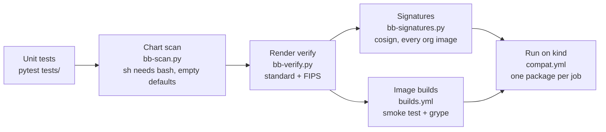

# Testing

Rendering Big Bang only proves that each value now names a Chainguard image. The packages
also have to **run** on those images, so testing has several layers. Each layer catches
things the one before can't.



| Layer | Runs | Catches |
|---|---|---|
| **Unit** (`tests/`) | every PR (`ci.yml`) | Tag selection, settings and org files, conversion rules and post-renderer patches, value-path discovery, Iron Bank recipe parsing, the image policy, object-storage credentials, the chart scan's rules, the leftovers report, and every `compat/*.yaml` being well formed |
| **Chart scan** (`bb-scan.py`) | every PR | Shell code run by `sh` that needs bash (Chainguard `-dev` images' `sh` is busybox; UBI's is bash), and empty chart defaults written into an app config. Each finding must be listed in `mapping.yaml` `scan_reviewed` with its fix. |
| **Render verify** (`bb-verify.py`) | every PR, standard and FIPS | An image the overlays don't convert; a non-FIPS image in the FIPS overlay |
| **Signatures** (`bb-signatures.py`) | every PR | An org image Chainguard didn't sign for your org, or a tag that doesn't exist. This found `neuvector-manager-fips:5.6`, which had no tags. |
| **Builds** (`builds.yml`) | PRs that touch `builds/`, and merges | A rebuilt image whose tools, versions, user or FIPS default changed; a fixable critical CVE |
| **Run on kind** (`compat.yml`) | PRs that touch `compat/`, or by hand | Anything that only shows up at runtime |

## Running packages on kind

```bash
# Locally, against a kind cluster you created (CI makes one per job):
export CGR_TOKEN=$(chainctl auth token --audience cgr.dev)
python scripts/bb-compat.py compat/loki.yaml [--fips]
```

Each `compat/<test>.yaml` names:

- the packages to enable;
- an optional trial mapping, to test an upgrade before `mapping.yaml` takes it;
- the images the test is about (`expect`);
- optional `setup` commands, `values`, `values_files`, `forbid_log`, and `debug` commands.

Each test then:

1. starts Flux and installs Big Bang with only those packages enabled;
2. waits until every HelmRelease is Ready, and every pod is Ready with no new restarts;
3. checks the **image policy** on everything running in the test namespaces and
   `flux-system`. Every image must be your org's, from your build registry, or an Iron Bank
   image the mapping keeps; in FIPS mode, `-fips` unless documented otherwise. This catches
   images injected at runtime, which rendering never sees;
4. reports each expected image as `EXERCISED` or `NOT EXERCISED`, so a pass never counts an
   image that didn't run.

## Results (Big Bang 3.35.1, 2026-10-29)

Every test in this table passes in standard and FIPS mode, except the ones marked new.

| Test | What runs | Notes |
|---|---|---|
| vault-2 | Vault **2.2.1** (`bigbang-vault`) | Big Bang pins 1.21. A fresh install; an upgrade with existing data was not tested. |
| sonarqube-26.10 | SonarQube **26.10** community | Big Bang pins 26.9 |
| alloy | grafana-alloy 1.21, config-reloader 0.94 | With Loki as the destination |
| argocd | dex 2.46, redis exporter 1.96 (`-iamguarded`) | |
| grafana | k8s-sidecar 2.14 | |
| harbor | redis exporter 1.96 (`-iamguarded`) | |
| headlamp | headlamp 0.46, `kubectl-dev` wait job | |
| kiali | kiali 2.34, Chainguard sidecars (`istio-init`, `istio-proxy`) | With Istio and a gateway |
| kyverno-reporter | policy-reporter 3.11, UI 2.9, plugin 0.7 | With Kyverno |
| loki | memcached-exporter 0.18, rollout-operator 0.41, k8s-sidecar 2.14 | |
| mimir | memcached-exporter 0.18, rollout-operator 0.41 | |
| monitoring | k8s-sidecar 2.14, config-reloader 0.94 | Blackbox and SNMP exporters are off by default |
| neuvector | controller, enforcer, manager, scanner 5.6 | Prometheus exporter not exercised |
| renovate | renovate 44.190 | A CronJob: installs only |
| kyverno-enforce | `restrict-image-registries` in Enforce with Headlamp and Grafana | Proves the overlay's allow list admits them |
| object-storage | Tempo on SeaweedFS (`OBJECT_STORAGE=seaweedfs`), no MinIO | Credentials only for enabled packages (see README) |
| keycloak (new) | Keycloak 26.8 with Big Bang's PostgreSQL | |
| external-secrets (new) | External Secrets Operator 2.12 | |
| fluentbit (new) | Fluent Bit 5.1 shipping to Loki | |
| gatekeeper (new) | Gatekeeper 3.23 and its kubectl jobs | |
| metrics-server (new) | metrics-server 0.9 | kind's kubelet certificates may need `--kubelet-insecure-tls` |
| thanos (new) | Thanos 0.42 with Prometheus, blocks on SeaweedFS | |
| velero (new) | Velero 1.18 and the AWS plugin, backups on SeaweedFS | |
| istio-ambient (new) | Istio CNI and ztunnel 1.31 | |
| installer (new) | `bb-install.py` end to end: Tempo on SeaweedFS, Keycloak | Generated S3 keys and Keycloak password |

## What the runtime tests found

None of these showed up when rendering. All are fixed in the overlays:

| Found by | Problem | Fix |
|---|---|---|
| Every test (Flux) | Chainguard's Flux controllers are a minor ahead of Big Bang's Flux CRDs | `flux/` installs the Flux release the controllers belong to |
| vault-2 | Big Bang's post-start hook needs `curl`, which Chainguard's vault doesn't have | `bigbang-vault` adds it |
| headlamp, alloy | Big Bang's jobs run `/bin/bash`, which Chainguard's `kubectl` doesn't have | `kubectl(-fips)-dev` |
| kiali | `istio-init` was built from `hub` + `proxy_init.image`, so it still pulled Iron Bank's | Overrides set `hub`, `tag` and `proxy_init.image` |
| kiali | The gateway wait job compares proxy tags with istiod's version label, which the chart sets to Big Bang's patch | A Flux post-renderer sets the label to the deployed patch |
| argocd, harbor | Bitnami's Redis chart starts the exporter with `/bin/bash -ec redis_exporter` | `prometheus-redis-exporter-iamguarded` |
| sonarqube | Its JMX init container needs Iron Bank's `/opt/jmx_exporter` jar, `sh` and `curl` | The JMX exporter stays on Iron Bank |
| kyverno-enforce | Kyverno policies' wait script is `#!/bin/sh` with bash arrays; busybox `sh` fails on it | `bash_wait_jobs`: a post-renderer runs it with bash |
| kyverno-enforce | Big Bang's non-root policies render `preconditions.all: null` with no excluded containers | The test excludes a placeholder container (Istio normally supplies the list) |
| object-storage | Tempo 2.10.10 refuses the chart's empty `opencensus` receiver, which Flux's render keeps even when our values set it to null | `overrides.tempo` replaces the chart's config template with a copy that omits it |
| object-storage | Big Bang creates Mimir's credential Secret even with Mimir off | Site file sets credentials only for enabled packages |

| velero | The chart's placeholder snapshot location has an empty credential that Flux keeps; Velero's CRD rejects it | No snapshot locations with S3 object storage |
| thanos | Big Bang writes Thanos's object storage Secret into `monitoring` before Flux creates it | Create `monitoring` first (the installer does) |
| keycloak (FIPS) | Big Bang's default admin password is too short for FIPS | Test password; the installer generates one |
| every PR (block mode) | cgr.dev serves layers and signatures from Cloudflare R2 | harden-runner allows `*.r2.cloudflarestorage.com` |

The two shell problems led to `bb-scan.py`, which found the same pattern in Alloy's upgrade
job (fixed by `bigbang-base` linking `sh` to bash, as UBI does) and Fortify's keystore job
(`bash_commands`).

## CI environment notes

These are kind-on-GitHub-Actions limits, not image problems:

- **One machine, several nodes.** A runner is a single machine with a 4-CPU allowance, so
  kind runs three workers to fit Big Bang's resource requests.
- **Shared kernel limits.** The nodes share the runner's kernel, so the job raises inotify
  limits (NeuVector's enforcers: "too many open files").
- **Disk space.** The job frees disk space first, because large images on four nodes filled
  the disk.
- **Rate limits.** Lookups of Flux releases on `api.github.com` use the job's token, since
  parallel jobs share the anonymous rate limit.
