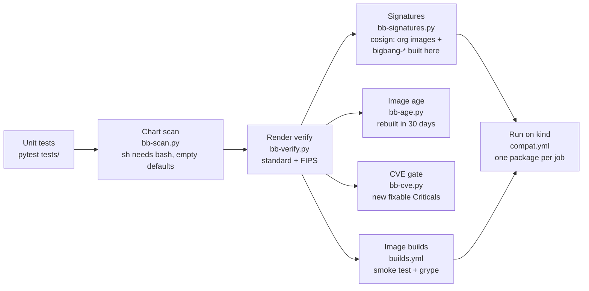
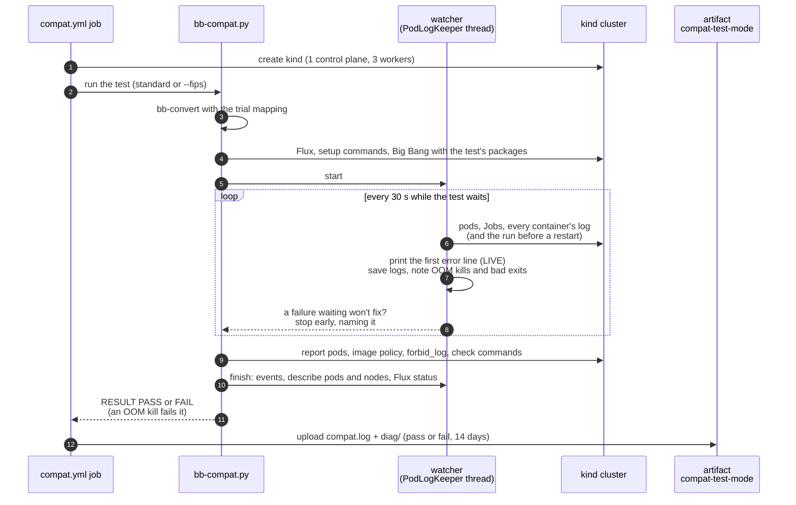

# Testing

Rendering Big Bang only proves that each value now names a Chainguard image. The packages
also have to **run** on those images, so testing has several layers. Each layer catches
things the one before can't.



| Layer | Runs | Catches |
|---|---|---|
| **Unit** (`tests/`) | every PR (`ci.yml`) | Tag selection, settings and org files, conversion rules and post-renderer patches, value-path discovery, Iron Bank recipe parsing, the image policy, object-storage credentials, the chart scan's rules, the leftovers report, and every `compat/*.yaml` being well formed |
| **Chart scan** (`bb-scan.py`) | every PR | Shell code run by `sh` that needs bash (Chainguard `-dev` images' `sh` is busybox; UBI's is bash), and empty chart defaults written into an app config. Each finding must be listed in `mapping.yaml` `scan_reviewed` with its fix. |
| **Render verify** (`bb-verify.py`) | every PR, standard and FIPS | An image the overlays don't convert; a non-FIPS image in the FIPS overlay; an org image left on a tag instead of its digest pin |
| **Signatures** (`bb-signatures.py`) | every PR | An org image Chainguard didn't sign for your org, a `bigbang-*` image `builds.yml` didn't sign on `main` (the signer is `BUILD_SIGNER`, else this repo), or a tag that doesn't exist. This found `neuvector-manager-fips:5.6`, which had no tags. |
| **Image age** (`bb-age.py`) | every PR | An org image not rebuilt in 30 days: a release line Chainguard stopped maintaining. Vault's kubectl 1.30 (19 Critical CVEs in FIPS) was one. |
| **CVE gate** (`bb-cve.py --changed-from`) | every PR | An image the change adds with a fixable Critical CVE. It logs into GHCR to scan the private `bigbang-*` images, and reports an image it can't scan as SCAN FAILED, not as a CVE. The weekly report lists each Critical with its fixed-in version. |
| **Builds** (`builds.yml`) | PRs that touch `builds/`, and merges | A rebuilt image whose tools, versions, user or FIPS default changed; a fixable critical CVE; a cosign without the signing flags `builds.yml` uses (`ci.yml` checks) |
| **Run on kind** (`compat.yml`) | PRs that touch `compat/`, or by hand | Anything that only shows up at runtime. A watcher reads every container's log during the test, prints errors as they happen and stops early on a failure that won't recover; an OOM kill fails the test. Each job uploads its logs and the cluster's state |
| **FIPS kernel** (`fips-kernel.yml`) | weekly, PRs that touch it, or by hand | What a kernel in FIPS mode changes for the FIPS overlay, which kind (the runner's Ubuntu kernel) can't show. See below |

## Running packages on kind

```bash
# Locally, against a kind cluster you created (CI makes one per job):
export CGR_TOKEN=$(chainctl auth token --audience cgr.dev)
python scripts/bb-compat.py compat/loki.yaml [--fips]
```

Each `compat/<test>.yaml` names:

- the packages to enable;
- an optional trial mapping, to test an upgrade before `mapping.yaml` takes it;
- the images the test is about (`expect`);
- optional `setup` commands, `values`, `values_files`, `forbid_log`, and `debug` commands;
- for an upgrade, `upgrade_from`: the mapping to install first and commands to run on it
  (write data) and after Big Bang is upgraded to the test's mapping;
- `registry1: true` when it pulls from Iron Bank. Without `REGISTRY1_USERNAME` and
  `REGISTRY1_PASSWORD` (repository secrets in CI) such a test prints `RESULT ...: SKIPPED`
  and exits 0: a missing account is not an image failure.

Each test then:

1. starts Flux and installs Big Bang with only those packages enabled;
2. waits until every HelmRelease is Ready, and every pod is Ready with no new restarts;
3. checks the **image policy** on everything running in the test namespaces and
   `flux-system`. Every image must be your org's, from your build registry, or an Iron Bank
   image the mapping keeps; in FIPS mode, `-fips` unless documented otherwise. This catches
   images injected at runtime, which rendering never sees;
4. reports each expected image as `EXERCISED` or `NOT EXERCISED`, so a pass never counts an
   image that didn't run: only a container that is running or exited 0 counts, not one in a
   Pending pod or one still pulling. A test where none of its expected images ran fails;
5. fails if any container was **OOMKilled** during the test, even one whose pod restarted
   and came up (the package doesn't fit its memory limit), and lists every other container
   that exited non-zero (`EXITED:`);
6. watches while it waits. Every 30 seconds it reads every container's log and prints the
   first error-looking line each one logs, as it happens (`LIVE <ns>/<pod> <container>:
   ...`: `rake aborted!`, `panic:`, a traceback, `FATAL`, `out of shared memory`, `x509:`,
   ...). It **stops the test early**, with `PROBLEM: stopped early: ...` naming the cause,
   on a failure that waiting won't fix: an OOM kill, a Job that used up its retries, a
   container stuck on `ImagePullBackOff` or a config error for 5 minutes (not an Iron Bank
   image when the run has no Iron Bank login: GitLab's upgrade check), or one restarted
   6 times (about 10 minutes) with an error line in its log; fewer is normal for apps that
   crash until a dependency is up (Harbor's jobservice restarts 3 times). A broken test
   then ends in minutes, not at its timeout;
7. keeps the evidence. While the test runs, every 30 seconds it saves each container's log,
   and after a restart the log of the run that ended, so a crash-looping pod's output
   survives Flux uninstalling a failed release. At the end it adds events, pod
   descriptions, `kubectl describe nodes` (what each node has allocated) and Flux's view of
   every source and HelmRelease.

One kind test, as `compat.yml` runs it:



### Reading a test's logs

Each kind job in CI uploads that evidence as the artifact `compat-<test>-<mode>`, pass or
fail, kept 14 days (on the run's page under Artifacts, or):

```bash
gh run download <run id> -n compat-gitlab-standard -D gitlab-logs
```

| File | What it holds |
|---|---|
| `compat.log` | the test's own output: `RESULT`, `PROBLEM`, `EXITED`, the pod report, `== debug` |
| `diag/exits.txt` | every container that was OOMKilled or exited non-zero, and when it was seen |
| `diag/logs/<namespace>/<pod>.<container>.log` | the container's last log (2000 lines) |
| `diag/logs/<namespace>/<pod>.<container>.previous.log` | the run before its last restart: why it crashed |
| `diag/cluster/<namespace>.txt` | pods, Deployments, Jobs, PVCs, Services, events, `describe pod` |
| `diag/cluster/nodes.txt` | node capacity and allocated requests (Pending pods: `Insufficient cpu`) |
| `diag/cluster/flux.txt` | every Flux source and HelmRelease, and `describe helmrelease -n bigbang` |

Run locally, the same files land in `<out>/diag` (the test prints the path), or in
`$COMPAT_DIAG` when set.

## Results (Big Bang 3.35.1, 2026-11-02)

Every test in this table passes in standard and FIPS mode on main's latest runs, except where the notes say otherwise. Every test has a `check` that proves the package does its job, not only that its pods are Ready (`tests/test_compat_files.py` requires one). Large tests run weekly and on demand; the rest on every pull request that touches what clusters run.

| Test | What runs | Notes |
|---|---|---|
| vault-2 | Vault **2.2.1** (`bigbang-vault`) | Big Bang pins 1.21. A fresh install; vault-upgrade covers existing data. Check: `vault status` initialized and unsealed; a KV v2 secret written and read back |
| vault-upgrade (skipped) | Iron Bank's Vault 1.21 with a KV secret, upgraded to `bigbang-vault` 2.x; the secret read back | Needs an Iron Bank login (`registry1: true`): **SKIPPED** in CI until the `REGISTRY1_USERNAME` and `REGISTRY1_PASSWORD` secrets exist |
| sonarqube-26.10 | SonarQube **26.10** community with its JMX exporter init container (`bigbang-jmx-exporter`, built and loaded by the test) | Big Bang pins 26.9 and turns the exporter on only with monitoring; the test turns it on and checks the javaagent serves JVM metrics |
| alloy | grafana-alloy 1.21, config-reloader 0.94 | With Loki as the destination. Check: Loki has pod logs and cluster events Alloy shipped |
| argocd | dex 2.46, redis exporter 1.96 (`-iamguarded`) | Check: `/api/version`; the admin gets a session; the controller writes status on a probe Application |
| grafana | k8s-sidecar 2.14 | Check: `/api/health` database ok; the dashboard sidecar picks up a labelled ConfigMap |
| harbor | redis exporter 1.96 (`-iamguarded`) | Check: `/api/v2.0/health` lists every component healthy |
| headlamp | headlamp 0.46, `kubectl-dev` wait job | Check: serves its UI and `/config`; reaches the API server through its cluster proxy |
| kiali | kiali 2.34, Chainguard sidecars (`istio-init`, `istio-proxy`) | With Istio and a gateway. Check: `/kiali/api` reports Kiali running with the Istio API (port-forward: STRICT mTLS refuses the API server proxy) |
| kyverno-reporter | policy-reporter 3.11, UI 2.9, plugin 0.7 | With Kyverno. Check: with Kyverno's policies on, PolicyReports exist, the API lists kyverno and the UI answers |
| loki | Loki 3.7 (monolithic) | Check: a pushed log line is found by `query_range`. Its memcached-exporter, rollout-operator and rules sidecar images don't run in Big Bang's default Loki (no caches, no distributed mode): the test listed only those, so it tested no image until `loki` was added |
| mimir | memcached-exporter 0.18, rollout-operator 0.41 | Check: a gauge written through the gateway's OTLP endpoint is read back from PromQL |
| monitoring | blackbox-exporter 0.29, snmp-exporter 0.31, config-reloader 0.94 | With Headlamp, Big Bang's trigger for the Blackbox exporter: a probe of Headlamp returns `probe_success 1`. The SNMP exporter (switched on by the test) serves metrics with its built-in `if_mib` config; FIPS keeps the standard SNMP image (no `-fips`). Monitoring's k8s-sidecar belongs to kube-prometheus-stack's Grafana, which Big Bang turns off; the grafana and loki tests run it |
| neuvector | controller, enforcer, manager, scanner 5.6, prometheus-exporter 1.1 | The exporter (the `monitor` subchart, switched on by the test without the monitoring stack) logs in as a `metrics` reader and serves `nv_` metrics |
| renovate | renovate 44.190 | A CronJob. Check: one run of it completes on Renovate's `local` platform (no git platform token in CI) |
| kyverno-enforce | `restrict-image-registries` in Enforce with Headlamp and Grafana | Proves the overlay's allow list admits them. Check: an org-image Pod is admitted and the same Pod from docker.io refused (server dry-run) |
| object-storage | Tempo on SeaweedFS (`OBJECT_STORAGE=seaweedfs`), no MinIO | Credentials only for enabled packages (see README). Check: a span sent over OTLP is found by trace ID and flushed to a block in the bucket |
| keycloak | Keycloak 26.8 with Big Bang's PostgreSQL | Check: the master realm's OIDC discovery (under `/auth`) and JWKS; the admin logs in with kcadm in the pod |
| external-secrets | External Secrets Operator 2.12 | Check: an ExternalSecret on ESO's `fake` provider syncs into a Secret |
| fluentbit | Fluent Bit 5.1 shipping to Loki | Check: Loki has the streams Fluent Bit labels |
| gatekeeper | Gatekeeper 3.23 and its kubectl jobs | Check: a docker.io Pod refused, an org-image Pod admitted, the audit ran (found the allow-list gap below) |
| metrics-server | metrics-server 0.9 | kind's kubelet certificates may need `--kubelet-insecure-tls`. Check: `kubectl top nodes` and `top pods` return numbers |
| thanos | Thanos 0.42 with Prometheus, blocks on SeaweedFS | Check: Query lists the sidecar and store gateway and answers `up` (found the DNS problem below) |
| velero | Velero 1.18 and the AWS plugin, backups on SeaweedFS | Check: a backup of a test namespace to SeaweedFS reaches Completed |
| istio-ambient | Istio CNI and ztunnel 1.31 | Check: traffic between two ambient pods goes through ztunnel over HBONE |
| installer | `bb-install.py` end to end: Tempo on SeaweedFS, Keycloak, chart downloaded from repo1 | Generated S3 keys and Keycloak password |
| installer-tls | Default TLS: cert-manager self-signed CA, `*.bigbang.test` on the public gateway | HTTPS through the gateway verified against the CA |
| installer-signatures | `--verify-signatures enforce` (the default): Kyverno policy for Chainguard's signatures and `builds.yml`'s | Policy Ready, a signed org image and a signed `bigbang-base` admitted, an unsigned tag refused |
| installer-gitops | `install --gitops`: Big Bang as a Flux HelmRelease from repo1 git and ConfigMaps | The `bigbang` HelmRelease Ready; nothing secret in the directory |
| istio-egress-gateway | Istio egress gateway beside istiod | Check: the egress waypoint is Programmed and its Envoy ready with config from istiod (the gateway renders only in ambient mode) |
| mattermost-operator | `bigbang-mattermost-operator` (built and loaded by the test) | Starts, takes its leader lease, watches its CRDs. Check: the operator takes a zero-replica Mattermost to `stable` and creates its Deployment |
| mattermost | Mattermost 11.11 (`mattermost`, `mattermost-fips`) run by `bigbang-mattermost-operator`, PostgreSQL on the org's image, files on SeaweedFS | No bundled PostgreSQL or MinIO; `/api/v4/system/ping` answers OK. The test lowers the server's 2-CPU request to fit kind |
| gitlab (large) | GitLab (webservice, sidekiq, Gitaly, Shell, registry, KAS, toolbox) with PostgreSQL and Redis on the org images (its chart needs external ones since v10), objects on SeaweedFS | Passes in both modes since 2026-11-01. It needed the sizing values under `upstream:`, PostgreSQL's `max_locks_per_transaction` at 256, a 40-minute Deployment progress deadline and 15 minutes before the liveness probe restarts Rails: see the findings below and the README's GitLab notes. Check: `/-/readiness?all=1` ok with the database and Gitaly checks; the sign-in page renders |
| gitlab-runner (large) | GitLab Runner registered with that GitLab, with Kyverno (which hands the runner its token) | Passes in both modes since 2026-11-02: the runner registers, loads its config from `/home/gitlab-runner/.gitlab-runner` and stays up (0 restarts). The test checks the registration log and forbids any `PANIC:`; it leaves out GitLab's registry, KAS and exporter, which the runner doesn't use |

## What the runtime tests found

None of these showed up when rendering. All are fixed in the overlays:

| Found by | Problem | Fix |
|---|---|---|
| Every test (Flux) | Chainguard's Flux controllers are a minor ahead of Big Bang's Flux CRDs | `flux/` installs the Flux release the controllers belong to |
| vault-2 | Big Bang's post-start hook needs `curl`, which Chainguard's vault doesn't have | `bigbang-vault` adds it |
| headlamp, alloy | Big Bang's jobs run `/bin/bash`, which Chainguard's `kubectl` doesn't have | `kubectl(-fips)-dev` |
| kiali | `istio-init` was built from `hub` + `proxy_init.image`, so it still pulled Iron Bank's | Overrides set `hub`, `tag` and `proxy_init.image` |
| kiali | The gateway wait job compares proxy tags with istiod's version label, which the chart sets to Big Bang's patch | A Flux post-renderer sets the label to the deployed patch |
| argocd, harbor | Bitnami's Redis chart starts the exporter with `/bin/bash -ec redis_exporter` | `prometheus-redis-exporter-iamguarded` |
| sonarqube | Its JMX init container needs Iron Bank's `/opt/jmx_exporter` jar, `sh` and `curl`, which Chainguard's `jmx-exporter-iamguarded` lacks | `bigbang-jmx-exporter`: the jar at Iron Bank's version on `busybox(-fips)-dev` |
| kyverno-enforce | Kyverno policies' wait script is `#!/bin/sh` with bash arrays; busybox `sh` fails on it | `bash_wait_jobs`: a post-renderer runs it with bash |
| kyverno-enforce | Big Bang's non-root policies render `preconditions.all: null` with no excluded containers | The test excludes a placeholder container (Istio normally supplies the list) |
| object-storage | Tempo 2.10.10 refuses the chart's empty `opencensus` receiver, which Flux's render keeps even when our values set it to null | `overrides.tempo` replaces the chart's config template with a copy that omits it |
| object-storage | Big Bang creates Mimir's credential Secret even with Mimir off | Site file sets credentials only for enabled packages |
| mattermost | The Mattermost Operator sets `MM_FILESETTINGS_AMAZONS3SSL=true` for every external file store (false only for a MinIO it manages), so Mattermost would speak HTTPS to an `http://` SeaweedFS endpoint (found reading the operator while writing the test) | The object-storage overlay sets it from the endpoint's scheme (`{ssl}` in `object-storage.yaml`) |
| velero | The chart's placeholder snapshot location has an empty credential that Flux keeps; Velero's CRD rejects it | No snapshot locations with S3 object storage |
| thanos | Monitoring depends on the `prometheusOperatorCRDs` package, which also creates the `monitoring` namespace | Keep it on (the installer's preflight checks) |
| keycloak (FIPS) | Big Bang's default admin (`password`) and database (`keycloak`) passwords are too short for FIPS ("password must be at least 112 bits") | Test passwords; the installer generates both on a fresh Keycloak |
| every PR (block mode) | cgr.dev serves layers and signatures from Cloudflare R2 | harden-runner allows `*.r2.cloudflarestorage.com` |
| keycloak | A Chainguard rebuild of 26.8.1 made `quarkus-application.dat` 0770 65532/65532; Big Bang's uid 1000 couldn't read it | `overrides.keycloak` runs as the image's user; digest pins stop a rebuild arriving untested |
| gitlab | Its chart sets `GODEBUG=tlskyber=0`, which newer Go refuses: Gitaly, Shell and the registry died at start | `overrides.gitlab` sets `tlsmlkem=0` |
| gitlab | Its migrations load the whole schema in one transaction; PostgreSQL's default `max_locks_per_transaction` (64) fails it with `out of shared memory`, so GitLab never starts | The test's PostgreSQL runs with 256. **A site's external PostgreSQL for GitLab needs it raised too** |
| gitlab | On a 2-CPU runner the migrations take about 10 minutes; webservice and sidekiq wait on them past Kubernetes' 10-minute `progressDeadlineSeconds`, the Deployment turns Failed and Helm stops the install (`failed early due to stalled resources`) | The test patches every GitLab Deployment to 2400 s (`compat/support/progress-deadline.py`, a post-renderer after the digest pins). A slow site cluster needs the same through `addons.gitlab.postRenderers` |
| gitlab | Webservice and Sidekiq (Rails) take more than the liveness probe's ~3 minutes (20 s, then 3 failures 60 s apart) to boot on a 2-CPU runner in FIPS mode; the probe killed them mid-boot until the test timed out | The test allows 15 failures (~15 minutes). A small or FIPS site cluster may need the same: `upstream.gitlab.webservice.deployment.livenessProbe` and `upstream.gitlab.sidekiq.livenessProbe` |
| gatekeeper | Big Bang's `allowed-docker-registries` constraint (deny) admits only Iron Bank's registries: with Gatekeeper on, every org image was refused ("invalid repository for image") | `bb-convert.py` writes Gatekeeper's allow list like Kyverno's (`registry_policies`): Iron Bank's registries, the org, `BUILD_REGISTRY` and every `ref` owner |
| thanos | Thanos Query had no stores: its default DNS resolver (miekgdns) tries the search domains first and stops at the first empty answer, and CI's Azure runners add one (AKS nodes do too). Pods were Ready the whole time. Not image-specific | `overrides.thanos` sets `--store.sd-dns-resolver=golang` (ships to deployments) |
| istio-egress-gateway | The test passed with its gateway never deployed ("0 of 1 expected images ran"): Big Bang renders `istioEgressGateway` only in ambient mode | The test enables `istioCNI` and `ztunnel`; `bb-compat.py` now fails a test where none of the expected images ran |
| gitlab-runner | In FIPS mode, with Kyverno and the runner beside GitLab, webservice was OOMKilled after 36 minutes under its 3G limit while its node was under MemoryPressure; the same webservice passes in `gitlab.yaml`. Most likely the 7 GB runner running out, not a limit too low | The runner test leaves out the container registry, KAS and the metrics exporter, which the runner doesn't use |
| gitlab-runner | Once it had a token, the runner registered and then crashed: `PANIC: creating directory: mkdir /.gitlab-runner: permission denied`. The chart mounts its writable config at `/home/gitlab-runner/.gitlab-runner`, Iron Bank's user's home; the Chainguard image's user has another home. Restarted, it registered again and GitLab rate-limited it | `overrides.gitlab-runner` sets `HOME=/home/gitlab-runner`; the test forbids any runner `PANIC:` |
| gitlab-runner | The test passed while the runner logged `PANIC: The registration-token needs to be entered`: its pod stays Ready without registering. Big Bang copies GitLab's runner token with a Kyverno policy (`autoRegister` needs Kyverno), and the test had Kyverno off | The test enables Kyverno, forbids that log line and checks the runner logs a successful registration. Sites: keep Kyverno on with GitLab Runner, or give the runner a token yourself |
| gitlab | Chart v10 has no bundled PostgreSQL or Redis | `compat/support/app-deps.py` deploys them from the org's images |
| mattermost (signatures) | Digest pins rendered as `name:@sha256` for an image with no tag | `kustomize_image` renders `name@digest` |
| cve-report | Vault's kubectl 1.30 pin resolved to the org's unmaintained 1.30 FIPS image (19 Critical) | `min_version: "1.34"` on kubectl |
| signatures (CI) | `builds.yml` pushed the release tag about a minute before signing it; a check in that window found the tag unsigned, and an enforcing cluster would refuse the Pod | Push `<tag>-staging`, sign its digest, then move `<tag>` |
| neuvector | The `monitor` subchart builds the exporter's image from its own `monitor.registry`, not `exporter.image.registry`; the conversion blanked it, so the image rendered as `/neuvector-prometheus-exporter:<tag>` (rendering missed it: the subchart installs only with monitoring) | `overrides.neuvector` sets `monitor.registry` to the org |
| monitoring | The SNMP exporter chart reads its pull secrets from top-level `imagePullSecrets`; Big Bang sets `snmpExporter.image.imagePullSecrets`, which nothing reads, so the pod pulled the org's image anonymously and never started (Iron Bank's would fail the same way) | `overrides.monitoring` sets `snmpExporter.imagePullSecrets` |
| cve-report | `devops-tester`'s chainsaw carried old grpc, x/net and go-jose (4 fixable Highs) | `GO_BUMPS` in `bb-devops-tester.py` raises them |

The two shell problems led to `bb-scan.py`, which found the same pattern in Alloy's upgrade
job (fixed by `bigbang-base` linking `sh` to bash, as UBI does) and Fortify's keystore job
(`bash_commands`).

## The FIPS overlay on a FIPS kernel

kind's nodes share the runner's kernel, and GitHub's Ubuntu kernel is not in FIPS mode, so
the kind tests run the FIPS images on a kernel that reports `fips_enabled = 0`. A STIG'd RHEL
node or an AKS FIPS node pool reports 1, and some FIPS modules (Keycloak's BC-FIPS, OpenSSL's
FIPS provider) look at it. `fips-kernel.yml` covers that gap:

1. checks the runner has `/dev/kvm` (without it a VM would be emulated, far too slow);
2. boots AlmaLinux 9 GenericCloud (pinned build and checksum) under QEMU/KVM, runs
   `fips-mode-setup --enable` and reboots: RHEL's documented way to put an installed system
   in FIPS mode (`fips=1` on the kernel command line, the FIPS crypto policy);
3. fails unless `/proc/sys/crypto/fips_enabled` is 1, then installs k3s (pinned, by checksum)
   and forwards its API to the runner (`.github/fips-vm.sh`);
4. runs `bb-compat.py compat/<test>.yaml --fips` against it for a few small tests
   (`kyverno-enforce`, `grafana`, `keycloak`), one VM per job;
5. checks `fips_enabled` again after the test, so a pass always means a FIPS kernel.

It runs weekly, on pull requests that change it, and by hand from main
(`gh workflow run fips-kernel.yml --ref main`). The artifact `fips-kernel-<test>` holds the
usual `compat.log` and `diag/`, plus the VM's kernel log, k3s log and serial console. SELinux
is permissive in the VM (k3s's SELinux policy is another package repository); the VM gets
2 CPUs and 5.5 GB of the runner's 7 GB.

## CI environment notes

These are kind-on-GitHub-Actions limits, not image problems:

- **One machine, several nodes.** A private repository's runner is one machine with 2 CPUs and
  7 GB (a public one: 4 CPUs, 16 GB). kind runs three workers on it, which share that CPU and memory, so tests lower requests (never limits) to fit.
- **Shared kernel limits.** The nodes share the runner's kernel, so the job raises inotify
  limits (NeuVector's enforcers: "too many open files").
- **Disk space.** The job frees disk space first, because large images on four nodes filled
  the disk.
- **Rate limits.** Lookups of Flux releases on `api.github.com` use the job's token, since
  parallel jobs share the anonymous rate limit.
- **Known flakes are retried.** A kind test reruns once when repo1.dso.mil refuses the
  runner (a source that can't fetch for 10 minutes ends the first try, so the retry runs
  before the job's time limit); a build reruns once on a transient package-fetch error; a GHCR push is tried
  three times, 30 seconds apart.

### Large tests

A compat file with `large: true` (GitLab, GitLab Runner) needs more memory and time than
the other tests (`timeout:` in seconds; the job gets 90 minutes). It runs in the weekly
`compat.yml` schedule (Sunday 06:00 UTC), on a pull request that changes only that test's
`compat/<test>.yaml` (`scripts/compat-plan.py` then runs just the changed tests), and by hand
from main: `gh workflow run compat.yml --ref main -f tests=gitlab,gitlab-runner`. A manual
run from another branch fails at the Chainguard login: the CI identity trusts main and pull
requests only.

A pull request that changes only `compat/*.yaml` files runs just those tests; any other
change that `compat.yml` watches (the mapping, overlays, the harness, `compat/support/`) runs
every test that isn't large.

MinIO and the MinIO operator have no kind test: their images stay on Iron Bank, which CI has
no credentials for. Mattermost is not large: `compat/mattermost.yaml` runs the server with
the operator built here, PostgreSQL from `compat/support/app-deps.py` and files on SeaweedFS.
