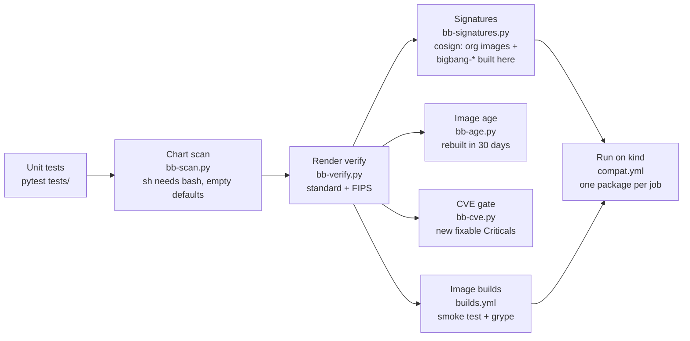

# Testing

Rendering Big Bang only proves that each value now names a Chainguard image. The packages
also have to **run** on those images, so testing has several layers. Each layer catches
things the one before can't.



| Layer | Runs | Catches |
|---|---|---|
| **Unit** (`tests/`) | every PR (`ci.yml`) | Tag selection, settings and org files, conversion rules and post-renderer patches, value-path discovery, Iron Bank recipe parsing, the image policy, object-storage credentials, the chart scan's rules, the leftovers report, and every `compat/*.yaml` being well formed |
| **Chart scan** (`bb-scan.py`) | every PR | Shell code run by `sh` that needs bash (Chainguard `-dev` images' `sh` is busybox; UBI's is bash), and empty chart defaults written into an app config. Each finding must be listed in `mapping.yaml` `scan_reviewed` with its fix. |
| **Render verify** (`bb-verify.py`) | every PR, standard and FIPS | An image the overlays don't convert; a non-FIPS image in the FIPS overlay; an org image left on a tag instead of its digest pin |
| **Signatures** (`bb-signatures.py`) | every PR | An org image Chainguard didn't sign for your org, a `bigbang-*` image `builds.yml` didn't sign on `main` (the signer is `BUILD_SIGNER`, else this repo), or a tag that doesn't exist. This found `neuvector-manager-fips:5.6`, which had no tags. |
| **Image age** (`bb-age.py`) | every PR | An org image not rebuilt in 30 days: a release line Chainguard stopped maintaining. Vault's kubectl 1.30 (19 Critical CVEs in FIPS) was one. |
| **CVE gate** (`bb-cve.py --changed-from`) | every PR | An image the change adds with a fixable Critical CVE. It logs into GHCR to scan the private `bigbang-*` images, and reports an image it can't scan as SCAN FAILED, not as a CVE. The weekly report lists each Critical with its fixed-in version. |
| **Builds** (`builds.yml`) | PRs that touch `builds/`, and merges | A rebuilt image whose tools, versions, user or FIPS default changed; a fixable critical CVE; a cosign without the signing flags `builds.yml` uses (`ci.yml` checks) |
| **Run on kind** (`compat.yml`) | PRs that touch `compat/`, or by hand | Anything that only shows up at runtime |

## Running packages on kind

```bash
# Locally, against a kind cluster you created (CI makes one per job):
export CGR_TOKEN=$(chainctl auth token --audience cgr.dev)
python scripts/bb-compat.py compat/loki.yaml [--fips]
```

Each `compat/<test>.yaml` names:

- the packages to enable;
- an optional trial mapping, to test an upgrade before `mapping.yaml` takes it;
- the images the test is about (`expect`);
- optional `setup` commands, `values`, `values_files`, `forbid_log`, and `debug` commands;
- for an upgrade, `upgrade_from`: the mapping to install first and commands to run on it
  (write data) and after Big Bang is upgraded to the test's mapping;
- `registry1: true` when it pulls from Iron Bank. Without `REGISTRY1_USERNAME` and
  `REGISTRY1_PASSWORD` (repository secrets in CI) such a test prints `RESULT ...: SKIPPED`
  and exits 0: a missing account is not an image failure.

Each test then:

1. starts Flux and installs Big Bang with only those packages enabled;
2. waits until every HelmRelease is Ready, and every pod is Ready with no new restarts;
3. checks the **image policy** on everything running in the test namespaces and
   `flux-system`. Every image must be your org's, from your build registry, or an Iron Bank
   image the mapping keeps; in FIPS mode, `-fips` unless documented otherwise. This catches
   images injected at runtime, which rendering never sees;
4. reports each expected image as `EXERCISED` or `NOT EXERCISED`, so a pass never counts an
   image that didn't run.

## Results (Big Bang 3.35.1, 2026-10-30)

Every test in this table passes in standard and FIPS mode, except the ones marked new.

| Test | What runs | Notes |
|---|---|---|
| vault-2 | Vault **2.2.1** (`bigbang-vault`) | Big Bang pins 1.21. A fresh install; vault-upgrade covers existing data |
| vault-upgrade (new, skipped) | Iron Bank's Vault 1.21 with a KV secret, upgraded to `bigbang-vault` 2.x; the secret read back | Needs an Iron Bank login (`registry1: true`): **SKIPPED** in CI until the `REGISTRY1_USERNAME` and `REGISTRY1_PASSWORD` secrets exist |
| sonarqube-26.10 | SonarQube **26.10** community with its JMX exporter init container (`bigbang-jmx-exporter`, built and loaded by the test) | Big Bang pins 26.9 and turns the exporter on only with monitoring; the test turns it on and checks the javaagent serves JVM metrics |
| alloy | grafana-alloy 1.21, config-reloader 0.94 | With Loki as the destination |
| argocd | dex 2.46, redis exporter 1.96 (`-iamguarded`) | |
| grafana | k8s-sidecar 2.14 | |
| harbor | redis exporter 1.96 (`-iamguarded`) | |
| headlamp | headlamp 0.46, `kubectl-dev` wait job | |
| kiali | kiali 2.34, Chainguard sidecars (`istio-init`, `istio-proxy`) | With Istio and a gateway |
| kyverno-reporter | policy-reporter 3.11, UI 2.9, plugin 0.7 | With Kyverno |
| loki | memcached-exporter 0.18, rollout-operator 0.41, k8s-sidecar 2.14 | |
| mimir | memcached-exporter 0.18, rollout-operator 0.41 | |
| monitoring | k8s-sidecar 2.14, config-reloader 0.94 | Blackbox and SNMP exporters are off by default |
| neuvector | controller, enforcer, manager, scanner 5.6 | Prometheus exporter not exercised |
| renovate | renovate 44.190 | A CronJob: installs only |
| kyverno-enforce | `restrict-image-registries` in Enforce with Headlamp and Grafana | Proves the overlay's allow list admits them |
| object-storage | Tempo on SeaweedFS (`OBJECT_STORAGE=seaweedfs`), no MinIO | Credentials only for enabled packages (see README) |
| keycloak (new) | Keycloak 26.8 with Big Bang's PostgreSQL | |
| external-secrets (new) | External Secrets Operator 2.12 | |
| fluentbit (new) | Fluent Bit 5.1 shipping to Loki | |
| gatekeeper (new) | Gatekeeper 3.23 and its kubectl jobs | |
| metrics-server (new) | metrics-server 0.9 | kind's kubelet certificates may need `--kubelet-insecure-tls` |
| thanos (new) | Thanos 0.42 with Prometheus, blocks on SeaweedFS | |
| velero (new) | Velero 1.18 and the AWS plugin, backups on SeaweedFS | |
| istio-ambient (new) | Istio CNI and ztunnel 1.31 | |
| installer (new) | `bb-install.py` end to end: Tempo on SeaweedFS, Keycloak, chart downloaded from repo1 | Generated S3 keys and Keycloak password |
| installer-tls (new) | Default TLS: cert-manager self-signed CA, `*.bigbang.test` on the public gateway | HTTPS through the gateway verified against the CA |
| installer-signatures (new) | `--verify-signatures enforce` (the default): Kyverno policy for Chainguard's signatures and `builds.yml`'s | Policy Ready, a signed org image and a signed `bigbang-base` admitted, an unsigned tag refused |
| installer-gitops (new) | `install --gitops`: Big Bang as a Flux HelmRelease from repo1 git and ConfigMaps | The `bigbang` HelmRelease Ready; nothing secret in the directory |
| istio-egress-gateway (new) | Istio egress gateway beside istiod | |
| mattermost-operator (new) | `bigbang-mattermost-operator` (built and loaded by the test) | Starts, takes its leader lease, watches its CRDs |
| mattermost (new) | Mattermost 11.11 (`mattermost`, `mattermost-fips`) run by `bigbang-mattermost-operator`, PostgreSQL on the org's image, files on SeaweedFS | No bundled PostgreSQL or MinIO; `/api/v4/system/ping` answers OK. The test lowers the server's 2-CPU request to fit kind |
| gitlab (new, large) | GitLab with PostgreSQL and Redis on the org images (its chart needs external ones since v10), objects on SeaweedFS | Weekly and on demand (`large: true`). **Not passing yet:** no crashes since the GODEBUG fix, but it times out on the private repo's 2-CPU, 7 GB runner (see the README's Known gaps) |
| gitlab-runner (new, large) | GitLab Runner registered with that GitLab | Weekly and on demand |

## What the runtime tests found

None of these showed up when rendering. All are fixed in the overlays:

| Found by | Problem | Fix |
|---|---|---|
| Every test (Flux) | Chainguard's Flux controllers are a minor ahead of Big Bang's Flux CRDs | `flux/` installs the Flux release the controllers belong to |
| vault-2 | Big Bang's post-start hook needs `curl`, which Chainguard's vault doesn't have | `bigbang-vault` adds it |
| headlamp, alloy | Big Bang's jobs run `/bin/bash`, which Chainguard's `kubectl` doesn't have | `kubectl(-fips)-dev` |
| kiali | `istio-init` was built from `hub` + `proxy_init.image`, so it still pulled Iron Bank's | Overrides set `hub`, `tag` and `proxy_init.image` |
| kiali | The gateway wait job compares proxy tags with istiod's version label, which the chart sets to Big Bang's patch | A Flux post-renderer sets the label to the deployed patch |
| argocd, harbor | Bitnami's Redis chart starts the exporter with `/bin/bash -ec redis_exporter` | `prometheus-redis-exporter-iamguarded` |
| sonarqube | Its JMX init container needs Iron Bank's `/opt/jmx_exporter` jar, `sh` and `curl`, which Chainguard's `jmx-exporter-iamguarded` lacks | `bigbang-jmx-exporter`: the jar at Iron Bank's version on `busybox(-fips)-dev` |
| kyverno-enforce | Kyverno policies' wait script is `#!/bin/sh` with bash arrays; busybox `sh` fails on it | `bash_wait_jobs`: a post-renderer runs it with bash |
| kyverno-enforce | Big Bang's non-root policies render `preconditions.all: null` with no excluded containers | The test excludes a placeholder container (Istio normally supplies the list) |
| object-storage | Tempo 2.10.10 refuses the chart's empty `opencensus` receiver, which Flux's render keeps even when our values set it to null | `overrides.tempo` replaces the chart's config template with a copy that omits it |
| object-storage | Big Bang creates Mimir's credential Secret even with Mimir off | Site file sets credentials only for enabled packages |

| mattermost | The Mattermost Operator sets `MM_FILESETTINGS_AMAZONS3SSL=true` for every external file store (false only for a MinIO it manages), so Mattermost would speak HTTPS to an `http://` SeaweedFS endpoint (found reading the operator while writing the test) | The object-storage overlay sets it from the endpoint's scheme (`{ssl}` in `object-storage.yaml`) |
| velero | The chart's placeholder snapshot location has an empty credential that Flux keeps; Velero's CRD rejects it | No snapshot locations with S3 object storage |
| thanos | Monitoring depends on the `prometheusOperatorCRDs` package, which also creates the `monitoring` namespace | Keep it on (the installer's preflight checks) |
| keycloak (FIPS) | Big Bang's default admin (`password`) and database (`keycloak`) passwords are too short for FIPS ("password must be at least 112 bits") | Test passwords; the installer generates both on a fresh Keycloak |
| every PR (block mode) | cgr.dev serves layers and signatures from Cloudflare R2 | harden-runner allows `*.r2.cloudflarestorage.com` |
| keycloak | A Chainguard rebuild of 26.8.1 made `quarkus-application.dat` 0770 65532/65532; Big Bang's uid 1000 couldn't read it | `overrides.keycloak` runs as the image's user; digest pins stop a rebuild arriving untested |
| gitlab | Its chart sets `GODEBUG=tlskyber=0`, which newer Go refuses: Gitaly, Shell and the registry died at start | `overrides.gitlab` sets `tlsmlkem=0` |
| gitlab | Chart v10 has no bundled PostgreSQL or Redis | `compat/support/app-deps.py` deploys them from the org's images |
| mattermost (signatures) | Digest pins rendered as `name:@sha256` for an image with no tag | `kustomize_image` renders `name@digest` |
| cve-report | Vault's kubectl 1.30 pin resolved to the org's unmaintained 1.30 FIPS image (19 Critical) | `min_version: "1.34"` on kubectl |
| signatures (CI) | `builds.yml` pushed the release tag about a minute before signing it; a check in that window found the tag unsigned, and an enforcing cluster would refuse the Pod | Push `<tag>-staging`, sign its digest, then move `<tag>` |
| cve-report | `devops-tester`'s chainsaw carried old grpc, x/net and go-jose (4 fixable Highs) | `GO_BUMPS` in `bb-devops-tester.py` raises them |

The two shell problems led to `bb-scan.py`, which found the same pattern in Alloy's upgrade
job (fixed by `bigbang-base` linking `sh` to bash, as UBI does) and Fortify's keystore job
(`bash_commands`).

## CI environment notes

These are kind-on-GitHub-Actions limits, not image problems:

- **One machine, several nodes.** A runner is a single machine with a 4-CPU allowance, so
  kind runs three workers to fit Big Bang's resource requests.
- **Shared kernel limits.** The nodes share the runner's kernel, so the job raises inotify
  limits (NeuVector's enforcers: "too many open files").
- **Disk space.** The job frees disk space first, because large images on four nodes filled
  the disk.
- **Rate limits.** Lookups of Flux releases on `api.github.com` use the job's token, since
  parallel jobs share the anonymous rate limit.
- **Known flakes are retried.** A kind test reruns once when repo1.dso.mil refuses the
  runner; a build reruns once on a transient package-fetch error; a GHCR push is tried
  three times, 30 seconds apart.

### Large tests

A compat file with `large: true` runs in the weekly `compat.yml` schedule (Sunday 06:00 UTC)
and when named in a manual run, not on pull requests: GitLab's dozen pods need more memory
and time (`timeout:` in seconds; the job gets 90 minutes) than a pull request should wait
for. MinIO and the MinIO operator have no kind test: their images stay on Iron Bank, which
CI has no credentials for. Mattermost is not large: `compat/mattermost.yaml` runs the server
with the operator built here, PostgreSQL from `compat/support/app-deps.py` and files on
SeaweedFS on every pull request that touches `compat/`.
